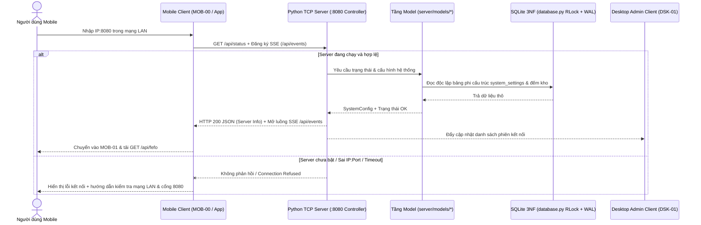
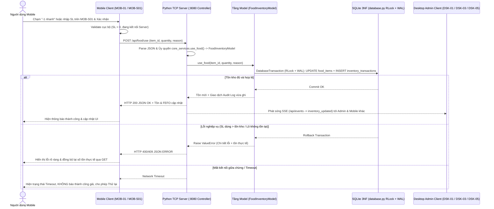

# TÀI LIỆU PHÂN TÍCH VÀ THIẾT KẾ CẤU TRÚC GIAO DIỆN DỰ KIẾN
**Hệ thống:** Quản lý Thực phẩm Gia đình & Đề xuất Tiêu thụ theo Thuật toán FEFO (Kiến trúc Client–Server)  
**Nguồn đặc tả chính thức:**
- [Phân rã chức năng.txt](file:///d:/SourceCode/lập%20trình%20mạng/Quan_ly_Thuc_Pham/docs/Phân%20rã%20chức%20năng.txt)
- [LTMQuanLyThucPhamGiaDinh.docx](file:///d:/SourceCode/lập%20trình%20mạng/Quan_ly_Thuc_Pham/docs/LTMQuanLyThucPhamGiaDinh.docx)
- [database/schema.sql](file:///d:/SourceCode/lập%20trình%20mạng/Quan_ly_Thuc_Pham/database/schema.sql) *(SQLite 3NF — 8 bảng & 2 Views)*
- Ma trận ánh xạ (`ma_tran_1_input_modules.png`, `ma_tran_2a_luong_modules.png`, `ma_tran_2b_modules_csdl.png`) và Lưu đồ chuẩn hóa (`sơ đồ các luồng - chuẩn hóa.docx`)

**Trạng thái:** `ĐÃ ĐỒNG BỘ SQLITE 3NF, TCP SOCKET :8080 + SSE & FIGMA (QT-01..QT-05, QT-07)`

---

## 1. TỔNG QUAN CẤU TRÚC GIAO DIỆN & PHÂN TÍCH TÀI LIỆU

### 1.1. Kết quả phân tích phạm vi tài liệu
Dựa trên đối chiếu toàn bộ cây phân rã chức năng trong `Phân rã chức năng.txt`, 12 yêu cầu chức năng (`FR-01` → `FR-12`), 8 thực thể (`ENT-01` → `ENT-08`), 7 module (`M01` → `M07`), 5 luồng dữ liệu (`D1` → `D5`) và lược đồ CSDL SQLite 3NF `database/schema.sql`, phạm vi nghiệp vụ của hệ thống gồm **4 khối chức năng chính**:

| Khối / Phân hệ | Phạm vi từ tài liệu nguồn | Chức năng cốt lõi |
|---|---|---|
| **PH-01: Đề xuất dùng trước (FEFO) & Gợi ý món ăn** | Cây `1.1` → `1.6`; `MOD-03`; `M03`; `D3`; `FR-08`, `FR-09`, `FR-10`; Đầu ra `1` | Lọc thực phẩm tồn kho (`status = 'ACTIVE'`, `SL > 0`); tính `DaysRemaining`; cô lập món quá hạn; xếp hạng FEFO 3 cấp (`expiration_date ASC`, FIFO `import_date ASC`, lô dở dang tồn ít); giải trình lý do; gợi ý món ăn phù hợp từ `recipes` (Match Score `+30%` cận hạn, bỏ qua gia vị cơ bản); cập nhật tức thời khi có biến động kho/HSD. |
| **PH-02: Quản lý Thực phẩm, Tồn kho & Tìm kiếm** | Cây `2.1` → `2.8`; `MOD-02`, `MOD-05`; `M01`, `M02`, `M05`; `D1`, `D2`, `D5`; `FR-01`–`FR-07`, `FR-12`; Đầu ra `2`, `6`, `7` | Thêm mới / nhập lô hàng (`POST /api/food/add`, kiểm tra trùng `2.1.10`, AI Vision Scan gắn `[Future Scope]`); sửa thông tin/HSD/vị trí; xuất dùng qua `POST /api/food/use` (`core_services.use_food`, hỗ trợ Quick Use `-1` 1 chạm); nhập thêm & kiểm kê điều chỉnh (`POST /api/food/adjust`); thanh lý/xóa mềm bảo toàn lịch sử (`POST /api/food/delete`); tìm kiếm từ khóa + lọc đa tiêu chí (`GET /api/inventory`). |
| **PH-03: Cảnh báo, Thống kê, Audit Log & Quản trị Danh mục/Cài đặt** | `Phân rã chức năng.txt` (Cài đặt ban đầu + Đầu ra `2b`, `3`, `4`, `5`); `MOD-01`, `MOD-04`, `MOD-06`; `M04`, `M06`, `M07`; `D4`; `FR-11` | Quét & phát cảnh báo kép (hết hạn / sắp hết hạn; tồn kho $\le$ `min_threshold` kèm danh sách cần mua bổ sung); Dashboard & thống kê theo thời gian, theo khu vực/vị trí; Nhật ký biến động (`inventory_transactions`); Quản trị danh mục (Loại, Đơn vị, Vị trí 2 cấp); Cấu hình hệ thống (`system_settings`: múi giờ, ngày hệ thống/mô phỏng, ngưỡng cảnh báo HSD, ngưỡng min mặc định, quy tắc FEFO). |
| **PH-04: Vận hành & Giao tiếp Client–Server** *(Từ bối cảnh hệ thống Desktop Server – Mobile Client)* | Bối cảnh đề bài Client–Server | Desktop Server vận hành dịch vụ lắng nghe mạng & quét nền tự động (System Tray + Server Monitor); Mobile Client thiết lập kết nối IP/Port tới Server, gửi yêu cầu nghiệp vụ, nhận phản hồi/đồng bộ cảnh báo và xử lý ngoại lệ mạng. *(Không thêm nghiệp vụ ngoài tài liệu).* |

### 1.2. Vai trò & Quyền hạn đối tượng sử dụng
Tài liệu đặc tả các cụm đối tượng gồm **Quản trị viên bếp ăn / Người vận hành Server** và **Người nội trợ / Thành viên gia đình**. Ánh xạ vào kiến trúc Desktop Server – Mobile Client:

| Vai trò | Thiết bị sử dụng | Quyền hạn & Phạm vi thao tác |
|---|---|---|
| **Admin (Quản trị viên & Vận hành Server)** | **Desktop Admin Client** *(chỉ dành cho Admin quản lý & thao tác với Server `:8080`)* | • Khởi động/tạm dừng/giám sát dịch vụ Python Server (`0.0.0.0:8080`), cấu hình mạng (Host/Port/CORS), chạy nền System Tray.<br>• Toàn quyền quản trị danh mục nền tảng (`categories`, `units`, `storage_locations`, `recipes`).<br>• Toàn quyền cấu hình `system_settings` (múi giờ, ngày hệ thống / mô phỏng thời gian, ngưỡng cảnh báo HSD, ngưỡng min mặc định, quy tắc FEFO).<br>• Xem Dashboard thống kê tổng thể, nhật ký giao dịch kho (Audit Log) toàn hệ thống, tra cứu và thực hiện các thao tác quản trị & hiệu chỉnh kho trên Desktop Admin Client. |
| **Người dùng cuối (Thành viên gia đình / Người nội trợ)** | **Mobile Client** *(người dùng chỉ dùng và thao tác trên điện thoại)* | • Kết nối vào Python Server (`:8080`) qua HTTP/1.1 REST JSON & Realtime SSE trong mạng nội bộ/mạng cho phép.<br>• Xem ưu tiên FEFO hôm nay, lý do đề xuất và công thức món ăn gợi ý.<br>• Xem cảnh báo hết hạn / sắp hết hạn / tồn thấp và danh sách cần mua bổ sung (gom 3 quầy).<br>• Tìm kiếm, lọc 5 tiêu chí và xem chi tiết đồ trong tủ lạnh/nhà bếp.<br>• Thao tác nghiệp vụ bếp hàng ngày trên điện thoại: thêm thực phẩm mới mua *(quét ảnh AI thuộc `[Future Scope]`)*, xuất dùng nhanh (`-1` / tùy chỉnh), nhập thêm, kiểm kê nhanh, đổi vị trí ngăn tủ, đánh dấu vứt hủy/thanh lý món hỏng.<br>• Xem thống kê gọn và lịch sử biến động (chỉ đọc đối với danh mục/cấu hình hệ thống từ Server — *xem Mục 8 để chốt phân quyền chi tiết*). |

### 1.3. Phân chia chức năng: Desktop Server vs. Mobile Client vs. Tương tác hai phía

1. **Chức năng chuyên biệt của Server & Desktop Admin Client (`Quản trị, Lưu trữ, Xử lý Model & Giám sát`)**:
   - **Python Server (`server/tcp_server.py :8080`)**: Tiếp nhận, xác thực cấu trúc HTTP/JSON và điều phối Request/Response; **Tầng Model (`server/models/*`)** đảm nhận toàn bộ xử lý dữ liệu, thuật toán FEFO (`FoodInventoryModel`), ghép công thức phi cấu trúc (`RecipeModel`), cấu hình hệ thống (`SystemConfigModel`) và giao dịch SQLite 3NF qua `server/database.py` (`RLock` + `WAL` mode).
   - **Desktop UI (`Desktop Admin Client`)**: Chỉ đóng vai trò là **Client quản trị** gửi Request tới Server `:8080` và nhận SSE `/api/events` (tuyệt đối không kết nối hoặc đọc thẳng cơ sở dữ liệu).
   - Chạy nền dịch vụ lắng nghe mạng (Server Listener) và tác vụ quét cảnh báo định kỳ (`D4`) ngay cả khi cửa sổ chính đang thu gọn về System Tray.
   - Giám sát trạng thái Server, danh sách Mobile Client đang kết nối, log Request/Response và sức khỏe kết nối DB.
   - Cấu hình tham số hệ thống (`system_settings`: múi giờ, ngày hệ thống, thanh mô phỏng thời gian demo FEFO, ngưỡng cảnh báo, quy tắc mức ưu tiên).
   - Quản trị danh mục gốc (`categories`, `units`, `storage_locations`, kho công thức `recipes`).
   - Xem bảng dữ liệu tồn kho mật độ cao, Dashboard thống kê chi tiết theo thời gian/khu vực và tra cứu toàn bộ Audit Log (`inventory_transactions`).

2. **Chức năng tối ưu trên Mobile Client (Tương tác nhanh tại bếp & khi đi chợ)**:
   - Thiết lập & kiểm tra kết nối tới Desktop Server (nhập địa chỉ/cổng hoặc quét QR từ Server).
   - Xem nhanh bảng ưu tiên FEFO hôm nay ("Ưu tiên dùng trước") và thực đơn gợi ý món ăn, kèm nút "Đã nấu / Dùng ngay".
   - Xem cảnh báo khẩn cấp và **Danh sách cần mua bổ sung** khi đang ở chợ/siêu thị.
   - Quét AI trực tiếp qua Camera/Thư viện ảnh điện thoại (`FR-03`, Đầu ra 7) để điền nhanh biểu mẫu thêm thực phẩm (`IN01`–`IN12`) ngay khi cất đồ vào tủ lạnh.
   - Tra cứu nhanh món trong ngăn tủ, cập nhật xuất dùng / kiểm kê số lượng / đổi vị trí / vứt hủy món hỏng bằng thao tác cảm ứng 1–2 chạm (Bottom Sheet).

3. **Các chức năng có tương tác Client–Server (Hai phía phối hợp)**:
   - Mọi thao tác đọc/ghi nghiệp vụ trên Mobile đều gửi yêu cầu tới **lớp dịch vụ nền (Background Server Service)** của Desktop Server:
     - **Mobile → Server**: Lấy danh sách FEFO & món ăn gợi ý (`D3`); lấy cảnh báo & danh sách cần mua (`D4`); tìm kiếm & lọc kho 5 tiêu chí (`D5`); xem chi tiết món & log món; gửi ảnh/yêu cầu nhận diện AI Vision (`FR-03`); kiểm tra trùng & thêm thực phẩm (`D1`); xuất dùng (`D2`), nhập thêm, kiểm kê điều chỉnh, đổi vị trí, sửa thông tin/HSD, thanh lý/xóa mềm; lấy danh mục (`categories`, `units`, `storage_locations`) và cấu hình ngưỡng hiện hành; lấy số liệu thống kê gọn.
     - **Server → Mobile**: Trả kết quả đã tính toán chuẩn từ DB (`view_fefo_recommendations`, `view_alerts`), mã lỗi validate (`SL > tồn`, `HSD < Ngày nhập`, trùng `food_code`), và **đẩy/đồng bộ cập nhật** khi tồn kho, cảnh báo hoặc cấu hình hệ thống thay đổi từ thiết bị khác hoặc từ tác vụ quét nền.

### 1.4. Quan hệ phụ thuộc và Trình tự thực hiện nghiệp vụ
1. **Khởi tạo nền tảng trước khi nhập kho (`M07` → `M01`)**: Phải tồn tại danh mục `categories`, `storage_locations`, `units` và `system_settings` trước khi tạo `foods` và `food_items`.
2. **Định nghĩa sản phẩm trước hoặc cùng lúc với lô tồn kho (`foods` → `food_items`)**: Khi thêm thực phẩm (`D1`), kiểm tra trùng theo `food_code` / `food_name`; nếu món đã có trong `foods`, tái sử dụng `food_id` và chỉ tạo lô `food_items` mới (khác HSD/vị trí).
3. **Mọi thay đổi tồn kho phải đi qua Tầng Model & Nhật ký biến động (`DatabaseTransaction` → `inventory_transactions` + `food_items`)**: Không sửa số lượng tồn trực tiếp bỏ qua log; xuất dùng gọi `POST /api/food/use` (`tcp_server.py` → `core_services.use_food()` → `FoodInventoryModel.use_food()` qua `DatabaseTransaction` `RLock + WAL` trong `server/database.py`) để cập nhật `current_quantity` nguyên tử, chèn bản ghi biến động vào `inventory_transactions`, và chuyển trạng thái khi tồn $\le 0$.
4. **Biến động kho/HSD tự động kích hoạt tính lại FEFO (`D1`/`D2`/`2.2.9`/`2.3` → `D3` & `D4`)**: Mọi thao tác thêm, xuất dùng, sửa HSD, hết hàng hoặc hết hạn đều lập tức cập nhật lại thứ tự FEFO, loại món hết hàng/quá hạn khỏi đề xuất và cập nhật lại bộ đếm cảnh báo + Dashboard (`1.6.1`–`1.6.5`).

### 1.5. Nguyên tắc & Triết lý tổ chức giao diện cho hai nền tảng
- **Desktop Server (`Operate` mode — Archetype D/E: Data Management Workbench + Server Monitor)**:
  - Khung làm việc toàn màn hình với Sidebar điều hướng trái (thu gọn được), Thanh trạng thái Server & Thời gian hệ thống cố định trên/dưới, Khu vực làm việc rộng ưu tiên bảng dữ liệu đa cột + Drawer chi tiết bên phải.
  - Phù hợp làm việc bằng chuột + bàn phím (`Ctrl+K` tìm nhanh, phím tắt thao tác, click dòng mở Drawer chi tiết), tránh mở quá nhiều cửa sổ rời rạc.
  - Hỗ trợ thu gọn về **System Tray** mà vẫn giữ **Server Listener + Background Alert Scheduler** hoạt động liên tục.
- **Mobile Client (`Operate` mode — Touch-first, 1 tay, luồng nhanh)**:
  - Tổ chức theo **4 Tab điều hướng đáy** tương ứng đúng 4 nhu cầu thường trực tại nhà bếp (`Hôm nay/FEFO`, `Kho tủ lạnh`, `Cảnh báo & Mua sắm`, `Thống kê & Kết nối`), kèm nút hành động nổi (`+ Thêm / Quét AI`) tại kho.
  - Không sao chép bảng 7–8 cột của Desktop sang màn hình điện thoại; thay bằng **Card thông tin phân tầng rõ ràng**, **Chip lọc ngang** kết hợp **Bottom Sheet bộ lọc**, và **Stepper `- / +` + nút preset** cho thao tác xuất dùng nhanh khi tay đang nấu ăn.

---

## 2. SCREEN HIERARCHY CỦA DESKTOP (SERVER APPLICATION)

### 2.1. Kiến trúc khung cửa sổ chính (Main Window Anatomy)

```text
┌───────────────────────────────────────────────────────────────────────────────┐
│ [≡] Quản lý Thực phẩm Gia đình — SERVER      [● Listening :8080 | 2 Clients]   │ ← Title / Server Bar
│     Múi giờ: Asia/Ho_Chi_Minh | Ngày HT: 2026-10-25 [-1d][+1d][+3d][+7d] [⚙]  │ ← System Time / Sim Bar
├───────────────┬───────────────────────────────────────────┬───────────────────┤
│ SIDEBAR       │ WORKSPACE CHÍNH (Thay đổi theo màn hình)  │ DETAIL DRAWER     │
│ (220px)       │                                           │ (360px - Ẩn/Hiện  │
│               │  - DSK-01: Tổng quan & Server Monitor     │  theo dòng chọn)  │
│ ▸ Tổng quan   │  - DSK-02: Đề xuất FEFO & Món ăn          │                   │
│ ▸ Đề xuất FEFO│  - DSK-03: Kho Thực phẩm (Bảng + 5 lọc)   │  Ảnh, thông tin   │
│ ▸ Kho thực phẩm  - DSK-04: Trung tâm Cảnh báo [Badge đỏ]  │  chi tiết lô hàng │
│ ▸ Cảnh báo [!]│  - DSK-05: Nhật ký Biến động (Audit Log)  │  & Log biến động  │
│ ▸ Nhật ký kho │  - DSK-06: Danh mục & Công thức (Tabs)    │  riêng của món    │
│ ── Quản trị ─ │  - DSK-07: Cài đặt & Cấu hình Server      │                   │
│ ▸ Danh mục    │                                           │  [Dùng][Sửa][Xóa] │
│ ▸ Cài đặt     │                                           │                   │
├───────────────┴───────────────────────────────────────────┴───────────────────┤
│ DB: SQLite WAL Connected │ Active Clients: 2 │ Cảnh báo: 4 │ Thu gọn khay hệ thống │ ← Status Bar (24px)
└───────────────────────────────────────────────────────────────────────────────┘
```

### 2.2. Sơ đồ phân cấp màn hình Desktop (Screen Hierarchy)

```text
DESKTOP SERVER APPLICATION
├── [Khung nền chạy ngầm] Server Background Service (Độc lập UI - chạy ngay khi mở/thu gọn Tray)
│   └── [Tray Popover] DSK-M06: Menu Khay hệ thống (System Tray)
│
└── [Cửa sổ chính] Main Workbench Window
    ├── [Màn hình chính] DSK-01: Bảng điều khiển Tổng quan & Giám sát Server
    │   └── (Liên kết nhanh tới DSK-02, DSK-04, DSK-05, DSK-07)
    │
    ├── [Màn hình chính] DSK-02: Đề xuất Thực phẩm Ưu tiên (FEFO) & Gợi ý Món ăn
    │   ├── [Modal] DSK-M03: Chi tiết Món ăn Gợi ý & Công thức Nấu (1.5.5.5, FR-10)
    │   └── [Modal] DSK-M02: Xuất dùng nhanh từ thẻ FEFO (POST /api/food/use)
    │
    ├── [Màn hình chính] DSK-03: Quản lý Thực phẩm, Tồn kho & Tìm kiếm Đa chiều (2.8)
    │   ├── [Drawer bên phải] DSK-03-D: Chi tiết Hồ sơ Thực phẩm & Lịch sử Lô (2.8.2)
    │   ├── [Modal] DSK-M01: Thêm / Sửa Thực phẩm & Lô hàng (Form 12 trường + AI Scan + Check trùng)
    │   ├── [Modal] DSK-M02: Thao tác Biến động Kho (Xuất dùng / Nhập thêm / Kiểm kê / Đổi vị trí)
    │   └── [Modal] DSK-M04: Xác nhận Thanh lý / Xóa mềm Thực phẩm (2.3.4)
    │
    ├── [Màn hình chính] DSK-04: Trung tâm Cảnh báo (Hết hạn / Sắp hết hạn & Sắp hết tồn kho)
    │   ├── [Tab 1] Cảnh báo Hạn sử dụng (Quá hạn & Cận hạn <= ngưỡng)
    │   ├── [Tab 2] Cảnh báo Tồn kho Tối thiểu & Danh sách Cần mua bổ sung
    │   └── (Mở lại DSK-M02 để Xuất dùng/Nhập thêm hoặc DSK-M04 để Vứt hủy/Thanh lý)
    │
    ├── [Màn hình chính] DSK-05: Nhật ký Biến động Kho (Audit Trail) (2.5.5, MOD-06)
    │   └── (Click dòng có thể mở nhanh DSK-03-D của lô liên quan)
    │
    ├── [Màn hình chính] DSK-06: Quản trị Danh mục Nền tảng & Công thức
    │   ├── [Tab 1] Loại thực phẩm (2.4)
    │   ├── [Tab 2] Đơn vị tính (2.6)
    │   ├── [Tab 3] Vị trí bảo quản 2 cấp (2.7)
    │   ├── [Tab 4] Kho công thức món ăn (recipes - FR-10)
    │   └── [Modal] DSK-M05: Biểu mẫu Thêm / Sửa Danh mục & Công thức
    │
    └── [Màn hình chính] DSK-07: Cài đặt Hệ thống & Cấu hình Kết nối Server
        ├── [Tab 1] Tham số Nghiệp vụ & Mô phỏng Ngày hệ thống (Múi giờ, Ngưỡng cảnh báo, Mức FEFO)
        └── [Tab 2] Cấu hình Mạng & Kết nối Server (IP, Port, Mã ghép nối/QR, Chạy nền Tray)
```

---

## 3. SCREEN HIERARCHY CỦA MOBILE (CLIENT APPLICATION)

### 3.1. Kiến trúc khung ứng dụng Mobile (Mobile App Shell Anatomy)

```text
┌────────────────────────────────────┐
│  Quản lý Tủ lạnh    [● LAN OK] [⟳] │ ← Top App Bar (Tên màn hình + Trạng thái kết nối Server)
├────────────────────────────────────┤
│  [Banner mất kết nối / Cảnh báo]   │ ← Contextual Status Banner (chỉ hiện khi cần)
│                                    │
│  Nội dung cuộn dọc ưu tiên thẻ     │
│  & thao tác chạm 1 tay             │
│  (Hôm nay / Kho / Cảnh báo / Thêm) │
│                                    │
│                            [ + ]   │ ← FAB (tại màn hình Kho: Thêm mới / Quét AI)
├────────────────────────────────────┤
│ [🔥 Hôm nay] [📦 Kho] [⚠️ Báo] [⚙️]│ ← Bottom Navigation Bar (4 Tab chính)
└────────────────────────────────────┘
```

### 3.2. Sơ đồ phân cấp màn hình Mobile (Screen Hierarchy)

```text
MOBILE CLIENT APPLICATION
├── [Màn hình khởi tạo] MOB-00: Kết nối Máy chủ Desktop Server (IP:Port / Quét QR / Kiểm tra kết nối)
│
└── [Vùng điều hướng chính - Bottom Navigation]
    ├── [Tab 1 - Màn hình chính] MOB-01: Trang chủ — Hôm nay dùng gì? (FEFO & Tổng quan nhanh)
    │   ├── [Màn hình con] MOB-03: Chi tiết Thực phẩm & Lô hàng
    │   ├── [Màn hình con] MOB-04: Thực đơn Gợi ý Món ăn Tiêu thụ (1.5.5.5, FR-10)
    │   └── [Bottom Sheet] MOB-S01: Xuất dùng nhanh / Đã nấu
    │
    ├── [Tab 2 - Màn hình chính] MOB-02: Kho Thực phẩm & Tủ lạnh (Danh sách, Tìm kiếm & Lọc)
    │   ├── [Bottom Sheet] MOB-S02: Bộ lọc Đa chiều 5 Tiêu chí (2.8.4–2.8.7)
    │   ├── [Màn hình con] MOB-03: Chi tiết Thực phẩm & Lô hàng (2.8.2 + Log riêng)
    │   │   ├── [Bottom Sheet] MOB-S01: Xuất dùng / Nhập thêm / Kiểm kê điều chỉnh (2.5)
    │   │   ├── [Bottom Sheet] MOB-S03: Đổi vị trí bảo quản 2 cấp (2.7.4)
    │   │   └── [Dialog] MOB-S05: Xác nhận Thanh lý / Vứt hủy thực phẩm (2.3.4)
    │   └── [Màn hình con] MOB-06: Thêm / Sửa Thực phẩm (Form 12 trường + Cảnh báo trùng)
    │       └── [Modal/Sheet] MOB-S04: Chụp / Chọn ảnh Quét AI Vision điền form (FR-03)
    │
    ├── [Tab 3 - Màn hình chính] MOB-05: Trung tâm Cảnh báo & Cần mua bổ sung
    │   ├── [Segment 1] Đồ Hết hạn & Sắp hết hạn (Chạm để Dùng ngay hoặc Vứt hủy)
    │   ├── [Segment 2] Đồ Sắp hết tồn kho — Danh sách Cần mua bổ sung (Chạm để Nhập thêm)
    │   └── (Mở MOB-S01, MOB-S05 hoặc MOB-03)
    │
    └── [Tab 4 - Màn hình chính] MOB-07: Thống kê, Nhật ký & Kết nối
        ├── [Section 1] Thống kê tồn kho & tiêu thụ theo vị trí / thời gian (rút gọn từ Đầu ra 4)
        ├── [Section 2] Lịch sử biến động gần đây (2.5.5)
        ├── [Section 3] Tra cứu Danh mục hiện có từ Server (Loại, Đơn vị, Vị trí)
        └── [Section 4] Trạng thái Kết nối Server (Chuyển tới MOB-00 để đổi/kết nối lại)
```

---

## 4. DANH SÁCH VÀ ĐẶC TẢ TỪNG MÀN HÌNH

### 4.1. Danh mục tổng hợp toàn bộ màn hình

| Mã | Tên màn hình | Ứng dụng | Phân loại | Phân hệ đảm nhiệm |
|---|---|---|---|---|
| `DSK-01` | Tổng quan & Giám sát Server | Desktop | Màn hình chính | PH-03 (Dashboard & Thống kê), PH-04 (Server Monitor) |
| `DSK-02` | Đề xuất Thực phẩm Ưu tiên (FEFO) & Gợi ý Món ăn | Desktop | Màn hình chính | PH-01 (`1.1`–`1.6`, `FR-09`, `FR-10`) |
| `DSK-03` | Quản lý Thực phẩm, Tồn kho & Tìm kiếm | Desktop | Màn hình chính | PH-02 (`2.2`, `2.5`, `2.8`, `FR-12`) |
| `DSK-03-D` | Drawer Chi tiết Hồ sơ Thực phẩm & Lịch sử Lô | Desktop | Drawer (Màn hình con) | PH-02 (`2.8.2`, `2.5.5`, Đầu ra `2`) |
| `DSK-04` | Trung tâm Cảnh báo Hạn dùng & Tồn kho | Desktop | Màn hình chính | PH-03 (`FR-11`, `D4`, Đầu ra `2b`, `3`) |
| `DSK-05` | Nhật ký Biến động Kho (Audit Trail) | Desktop | Màn hình chính | PH-03 (`2.5.5`, `MOD-06`, Đầu ra `5`) |
| `DSK-06` | Quản trị Danh mục Nền tảng & Công thức | Desktop | Màn hình chính (Tabs) | PH-02/PH-03 (`2.4`, `2.6`, `2.7`, `FR-01`, `FR-07`, `FR-10`) |
| `DSK-07` | Cài đặt Hệ thống & Cấu hình Kết nối Server | Desktop | Màn hình chính (Tabs) | PH-03 (`Cài đặt ban đầu`), PH-04 (Cấu hình Server) |
| `DSK-M01` | Modal Thêm / Sửa Thực phẩm & Quét AI | Desktop | Hộp thoại Modal | PH-02 (`2.1`, `2.2`, `FR-02`, `FR-03`) |
| `DSK-M02` | Modal Biến động Kho (Xuất dùng / Nhập thêm / Kiểm kê / Đổi vị trí) | Desktop | Hộp thoại Modal | PH-02 (`2.5`, `2.7.4`, `FR-04`, `FR-05`) |
| `DSK-M03` | Modal Chi tiết Món ăn Gợi ý & Công thức | Desktop | Hộp thoại Modal | PH-01 (`1.5.5.5`, `FR-10`) |
| `DSK-M04` | Modal Xác nhận Thanh lý / Xóa mềm | Desktop | Hộp thoại Modal | PH-02 (`2.3`, `FR-06`) |
| `DSK-M05` | Modal Thêm / Sửa Danh mục & Công thức | Desktop | Hộp thoại Modal | PH-02/PH-03 (`2.4`, `2.6`, `2.7`, `FR-10`) |
| `DSK-M06` | Popover Khay Hệ thống (System Tray) | Desktop | Transient Surface | PH-04 (Vận hành Server nền) |
| `MOB-00` | Kết nối Máy chủ Desktop Server | Mobile | Màn hình khởi tạo | PH-04 (Kết nối Client–Server) |
| `MOB-01` | Trang chủ — Hôm nay dùng gì? (FEFO) | Mobile | Màn hình chính (Tab 1) | PH-01 (`1.1`–`1.6`), PH-03 (Tổng quan & Cảnh báo nhanh) |
| `MOB-02` | Kho Thực phẩm & Tủ lạnh | Mobile | Màn hình chính (Tab 2) | PH-02 (`2.8`, `FR-12`) |
| `MOB-03` | Chi tiết Thực phẩm & Lô hàng | Mobile | Màn hình con | PH-02 (`2.8.2`, `2.5.2`, `2.5.5`) |
| `MOB-04` | Thực đơn Gợi ý Món ăn Tiêu thụ | Mobile | Màn hình con | PH-01 (`1.5.5.5`, `FR-10`) |
| `MOB-05` | Trung tâm Cảnh báo & Cần mua bổ sung | Mobile | Màn hình chính (Tab 3) | PH-03 (`FR-11`, `D4`, Đầu ra `2b`, `3`) |
| `MOB-06` | Thêm / Sửa Thực phẩm | Mobile | Màn hình con | PH-02 (`2.1`, `2.2`, `FR-02`) |
| `MOB-07` | Thống kê, Nhật ký & Kết nối | Mobile | Màn hình chính (Tab 4) | PH-03 (Thống kê gọn, Audit Log, Danh mục), PH-04 |
| `MOB-S01` | Bottom Sheet Xuất dùng / Nhập thêm / Kiểm kê | Mobile | Bottom Sheet | PH-02 (`2.5`, `FR-04`, `FR-05`) |
| `MOB-S02` | Bottom Sheet Bộ lọc Đa chiều 5 Tiêu chí | Mobile | Bottom Sheet | PH-02 (`2.8.3`–`2.8.7`, `FR-12`) |
| `MOB-S03` | Bottom Sheet Đổi vị trí Bảo quản 2 cấp | Mobile | Bottom Sheet | PH-02 (`2.7.4`, `FR-07`) |
| `MOB-S04` | Sheet / Camera Quét nhãn & hóa đơn AI Vision | Mobile | Modal / Sheet | PH-02 (`FR-03`, Đầu ra `7`) |
| `MOB-S05` | Hộp thoại Xác nhận Thanh lý / Vứt hủy | Mobile | Hộp thoại Dialog | PH-02 (`2.3`, `FR-06`) |

---

### 4.2. Đặc tả chi tiết từng màn hình — DESKTOP SERVER (`DSK-*`)

#### DSK-01: Tổng quan & Giám sát Server
1. **Mã màn hình**: `DSK-01`
2. **Tên màn hình**: Bảng điều khiển Tổng quan & Giám sát Server
3. **Ứng dụng sở hữu**: Desktop (Server)
4. **Phân hệ và chức năng tương ứng**:
   - PH-03: Dashboard & Thống kê (Đầu ra `4`, `M06`); tóm tắt Cảnh báo (`M04`), tóm tắt FEFO (`M03`).
   - PH-04: Khởi động/Dừng/Giám sát dịch vụ Client–Server.
5. **Mục đích sử dụng**: Cung cấp cái nhìn toàn cảnh về sức khỏe kho thực phẩm gia đình (tổng lượng tồn, món cận hạn/quá hạn, món sắp hết, xu hướng tiêu thụ theo thời gian & theo khu vực) đồng thời giám sát trạng thái hoạt động của Desktop Server, số Mobile Client đang kết nối và nhật ký giao tiếp mạng theo thời gian thực.
6. **Thành phần giao diện**:
   - Header thanh thời gian hệ thống & mô phỏng ngày (`-1d`, `+1d`, `+3d`, `+7d`, `Tùy chỉnh`).
   - Hàng thẻ KPI tổng hợp (4 thẻ số liệu).
   - Khối biểu đồ thống kê (Biểu đồ xu hướng sử dụng/nhập theo khoảng thời gian + Biểu đồ phân bố tồn kho & tiêu thụ theo Khu vực/Vị trí: Trong tủ lạnh vs Ngoài tủ lạnh).
   - Bảng rút gọn Top thực phẩm cần dùng gấp hôm nay (FEFO Ưu tiên Cao) & Cảnh báo khẩn.
   - Panel Giám sát Server (Server Monitor Console): Trạng thái Listener (Đang chạy/Đã dừng), Địa chỉ IP:Port, Danh sách thiết bị Mobile Client đang kết nối, Bảng log Request/Response gần nhất, Nút `Bật/Tạm dừng Server`, `Hiển thị QR kết nối`.
7. **Thông tin hiển thị**:
   - Tổng số lô thực phẩm đang quản lý, tổng số lượng theo nhóm; số món Đã hết hạn / Sắp hết hạn ($\le$ ngưỡng); số món Cạn kho ($\le$ `min_threshold`); số Client đang kết nối; trạng thái kết nối CSDL SQLite WAL (`RLock`); IP LAN & TCP Port `8080` đang lắng nghe; thời gian & loại request từ Mobile.
8. **Các thao tác người dùng**:
   - Chọn khoảng thời gian thống kê (7 ngày / 30 ngày / tùy chọn `Date Range`).
   - Nhấn thẻ KPI hoặc "Xem tất cả" để nhảy tới `DSK-02`, `DSK-03`, `DSK-04`.
   - Bật/Tạm dừng Server Listener, ngắt kết nối một Client, mở QR kết nối, xóa màn hình log mạng.
   - Thao tác mô phỏng ngày (`-1d`, `+1d`, `+3d`, `+7d`) để kiểm chứng FEFO & Cảnh báo.
9. **Luồng điều hướng**:
   - Mở mặc định khi khởi chạy cửa sổ chính Desktop.
   - Điều hướng trực tiếp qua Sidebar hoặc các liên kết nhanh đến `DSK-02`, `DSK-03`, `DSK-04`, `DSK-05`, `DSK-07`.
10. **Trạng thái giao diện cần thiết**:
    - `Server Running` (xanh, hiển thị `IP:8080` & danh sách Client), `Server Stopped` (cảnh báo Mobile không thể kết nối), `DB Error` (lỗi truy xuất SQLite — khóa thao tác kho), `Empty Inventory` (chưa có thực phẩm, gợi ý nút `+ Nhập thực phẩm đầu tiên`), `Loading Skeleton` cho biểu đồ.

---

#### DSK-02: Đề xuất Thực phẩm Ưu tiên (FEFO) & Gợi ý Món ăn
1. **Mã màn hình**: `DSK-02`
2. **Tên màn hình**: Đề xuất Thực phẩm cần sử dụng trước (FEFO) & Gợi ý Món ăn
3. **Ứng dụng sở hữu**: Desktop (Server)
4. **Phân hệ và chức năng tương ứng**:
   - PH-01: Toàn bộ nhóm `1.1` → `1.6` (`FR-08`, `FR-09`, `FR-10`, `M03`, `D3`, Đầu ra `1`).
5. **Mục đích sử dụng**: Hiển thị danh sách thực phẩm đủ điều kiện đã được sắp xếp chuẩn hóa theo thuật toán FEFO (kèm FIFO tie-breaker khi trùng hạn) và phân tầng 3 mức độ ưu tiên, giải trình lý do ưu tiên rõ ràng, kết hợp gợi ý món ăn phù hợp và cho phép xuất dùng tức thì.
6. **Thành phần giao diện**:
   - Thanh tóm tắt đếm nhanh theo 3 mức: `Ưu tiên Cao`, `Ưu tiên Trung bình`, `Ưu tiên Thấp` (kèm liên kết sang cảnh báo món `Đã hết hạn` bị loại khỏi FEFO theo quy tắc `1.2.4.4`).
   - Thanh bộ lọc nhanh theo Khu vực/Vị trí (`1.1.1.1`–`1.1.1.4`) và Mức độ ưu tiên (`1.4`).
   - Nút/Panel "Xem giải trình quy tắc FEFO" (hiển thị ngày HT đang tính, ngưỡng phân mức, thứ tự tie-breaker).
   - Danh sách thẻ hoặc bảng sắp xếp theo thứ tự ưu tiên (`#1`, `#2`, `#3`...), mỗi mục có nút `Gợi ý món ăn` và `Dùng thực phẩm`.
   - Khối gợi ý món ăn tổng hợp phía dưới/bên phải (các món có thể nấu từ nhóm nguyên liệu Ưu tiên Cao).
7. **Thông tin hiển thị**:
   - Thứ tự ưu tiên (`#1..#n`), Tên thực phẩm, Mã, Phân loại, Vị trí bảo quản (`Trong/Ngoài tủ lạnh` + ngăn chi tiết), Số lượng tồn & đơn vị, Ngày nhập, Hạn sử dụng, Số ngày còn lại (`DaysRemaining`), Nhãn mức độ ưu tiên (`Cao` / `Trung bình` / `Thấp`), Lý do đề xuất (`1.5.2`), Danh sách món ăn phù hợp (`1.5.5.5`).
8. **Các thao tác người dùng**:
   - Lọc theo vị trí bảo quản hoặc mức ưu tiên.
   - Bấm `Gợi ý món ăn` trên 1 thực phẩm (hoặc chọn món từ khối gợi ý chung) → mở `DSK-M03`.
   - Bấm `Dùng thực phẩm` → mở `DSK-M02` (chế độ Xuất dùng).
   - Bấm vào tên thực phẩm → mở Drawer `DSK-03-D`.
9. **Luồng điều hướng**:
   - Vào từ Sidebar hoặc từ `DSK-01`.
   - Mở modal `DSK-M03` (công thức), `DSK-M02` (xuất dùng), hoặc Drawer `DSK-03-D`. Nếu có món hết hạn mới phát sinh, hiển thị link chuyển sang `DSK-04`.
10. **Trạng thái giao diện cần thiết**:
    - `Populated` (phân màu Đỏ / Vàng cam / Xanh theo 3 mức ưu tiên), `Empty FEFO` (không có thực phẩm còn hạn & còn số lượng), `No Recipe Match` (chưa có công thức khớp nguyên liệu ưu tiên cao), `Loading`, `Time-Simulated` (banner nhắc đang chạy ở ngày giả lập nếu khác ngày thực tế).

---

#### DSK-03: Quản lý Thực phẩm, Tồn kho & Tìm kiếm
1. **Mã màn hình**: `DSK-03`
2. **Tên màn hình**: Quản lý Thực phẩm, Tồn kho & Tìm kiếm Đa chiều
3. **Ứng dụng sở hữu**: Desktop (Server)
4. **Phân hệ và chức năng tương ứng**:
   - PH-02: `2.1` (khởi phát thêm), `2.2` (xem danh sách/chọn sửa), `2.3` (chọn xóa), `2.5` (quản lý số lượng), `2.7` (chọn/đổi vị trí), `2.8` (`2.8.1`, `2.8.3`–`2.8.7`, `FR-12`, `M05`, `D5`, Đầu ra `2`, `6`).
5. **Mục đích sử dụng**: Không gian làm việc chính để quản lý toàn bộ danh sách lô thực phẩm trong tủ lạnh và nhà bếp; hỗ trợ tìm kiếm từ khóa và lọc kết hợp 5 tiêu chí độc lập; cung cấp đầy đủ thao tác nghiệp vụ trực tiếp trên từng dòng.
6. **Thành phần giao diện**:
   - Toolbar hành động trên cùng: Nút `+ Thêm thực phẩm mới` (nổi bật), nút `Quét AI từ ảnh`, nút `Xóa bộ lọc`, nút `Làm mới (F5)`.
   - Thanh tìm kiếm & Bộ lọc 5 tiêu chí (`IN15`):
     1. Ô tìm kiếm từ khóa (Tên, Mã, Loại thực phẩm — `2.8.3`).
     2. Dropdown Loại thực phẩm (`2.8.4`).
     3. Dropdown Khu vực (`Trong tủ lạnh` / `Ngoài tủ lạnh` — `2.8.5`).
     4. Dropdown Vị trí chi tiết (`2.8.5`).
     5. Dropdown Trạng thái số lượng (`Đang sử dụng`, `Sắp hết`, `Đã hết`, `Đã hủy` — `2.8.6`).
     6. Dropdown Tình trạng hạn sử dụng (`Đã hết hạn`, `Sắp hết hạn`, `Còn hạn` — `2.8.7`).
   - Bảng dữ liệu tồn kho (Data Grid) hỗ trợ sắp xếp theo cột, phân trang, thanh đếm tổng kết quả khớp.
   - Các nút thao tác nhanh trên từng dòng: `Xem chi tiết`, `Sửa thông tin`, `Xuất dùng / Kiểm kê / Nhập thêm`, `Đổi vị trí`, `Thanh lý / Xóa mềm`.
   - Menu chuột phải (Context menu) trên từng dòng.
7. **Thông tin hiển thị**:
   - Ảnh thu nhỏ + Tên thực phẩm + Mã (`TPxxx`), Loại thực phẩm, Khu vực & Vị trí chi tiết, Số lượng hiện tại + Đơn vị + Badge cảnh báo dưới min, Ngày nhập, Hạn sử dụng + Số ngày còn lại, Mức ưu tiên FEFO, Trạng thái tồn kho (`Đang sử dụng` / `Đã hết` / `Đã hủy`).
8. **Các thao tác người dùng**:
   - Nhập từ khóa, chọn/bỏ chọn kết hợp 5 bộ lọc.
   - Bấm `+ Thêm thực phẩm mới` hoặc `Quét AI` → mở `DSK-M01`.
   - Click 1 dòng hoặc nút `Xem` → mở Drawer `DSK-03-D`.
   - Bấm `Sửa` → mở `DSK-M01` (chế độ Sửa).
   - Bấm `Dùng / Kiểm kê / Nhập thêm / Đổi vị trí` → mở `DSK-M02`.
   - Bấm `Xóa / Thanh lý` → mở `DSK-M04`.
9. **Luồng điều hướng**:
   - Vào từ Sidebar.
   - Liên kết trực tiếp tới `DSK-03-D` (Drawer phải), `DSK-M01`, `DSK-M02`, `DSK-M04`.
10. **Trạng thái giao diện cần thiết**:
    - `Populated` (hiện đầy đủ bảng và màu phân biệt dòng quá hạn/sắp hết), `Empty Warehouse` (kho chưa có dữ liệu), `Empty Filter Result` (không tìm thấy kết quả khớp bộ lọc kèm nút `Xóa bộ lọc`), `Loading`, `Row Selected` (highlight đồng bộ với `DSK-03-D`), `Error`.

---

#### DSK-03-D: Drawer Chi tiết Hồ sơ Thực phẩm & Lịch sử Lô
1. **Mã màn hình**: `DSK-03-D`
2. **Tên màn hình**: Drawer Chi tiết Hồ sơ Thực phẩm & Lịch sử Lô
3. **Ứng dụng sở hữu**: Desktop (Server)
4. **Phân hệ và chức năng tương ứng**:
   - PH-02: `2.8.2` (`2.8.2.1`–`2.8.2.6`), `2.5.2`, `2.5.5` (log riêng của lô); Đầu ra `2` (Chi tiết hồ sơ thực phẩm).
5. **Mục đích sử dụng**: Hiển thị đầy đủ 12+ thuộc tính chi tiết của một thực phẩm và lô hàng đang chọn ngay cạnh bảng tồn kho mà không cần chuyển trang, giúp kiểm tra toàn bộ thông tin (ảnh, thương hiệu, mô tả, ngưỡng min, ghi chú, log biến động) trước khi thao tác.
6. **Thành phần giao diện**:
   - Header Drawer (Tên thực phẩm, Mã `food_code`, Badge trạng thái & nút đóng `✕`).
   - Khối Ảnh sản phẩm & Thông tin định danh (`foods`: Loại, Thương hiệu, Mô tả).
   - Khối Thông tin Lô tồn kho (`food_items`: Số lượng hiện tại / Đơn vị, Ngưỡng tồn tối thiểu, Khu vực & Vị trí bảo quản chi tiết, Ngày nhập, Hạn sử dụng, Số ngày còn lại, Mức ưu tiên FEFO, Ghi chú lô).
   - Khối Lịch sử biến động riêng của lô (`inventory_transactions`: thời gian, loại hành động, lượng thay đổi, tồn sau giao dịch, lý do).
   - Footer hành động cố định: `Xuất dùng`, `Kiểm kê/Nhập`, `Sửa`, `Xóa mềm`.
7. **Thông tin hiển thị**:
   - Toàn bộ thông tin chi tiết của `foods` + `food_items` + các bản ghi `inventory_transactions` gần nhất của `item_id` đó.
8. **Các thao tác người dùng**:
   - Đóng Drawer (`✕` hoặc `Esc`).
   - Chuyển nhanh sang lô khác bằng cách click dòng khác trên `DSK-03`.
   - Kích hoạt nhanh `Xuất dùng`, `Nhập thêm`, `Kiểm kê`, `Đổi vị trí` (`DSK-M02`), `Sửa` (`DSK-M01`), `Thanh lý` (`DSK-M04`), hoặc `Xem toàn bộ lịch sử tại Audit Log` (`DSK-05` lọc theo món).
9. **Luồng điều hướng**:
   - Trượt ra từ cạnh phải khi chọn dòng trên `DSK-03`, `DSK-02`, hoặc `DSK-05`.
10. **Trạng thái giao diện cần thiết**:
    - `Hidden`, `Loading`, `Loaded`, `No Transaction History` (chỉ mới có giao dịch nhập ban đầu hoặc chưa phát sinh thêm), `Item Deleted/Updated` (tự làm mới khi Mobile vừa tác động vào chính lô đó).

---

#### DSK-04: Trung tâm Cảnh báo Hạn dùng & Tồn kho
1. **Mã màn hình**: `DSK-04`
2. **Tên màn hình**: Trung tâm Cảnh báo (Hạn sử dụng & Tồn kho Tối thiểu)
3. **Ứng dụng sở hữu**: Desktop (Server)
4. **Phân hệ và chức năng tương ứng**:
   - PH-03: `D4`, `M04`, `FR-11`, Đầu ra `2b` (Cảnh báo hạn sử dụng), Đầu ra `3` (Cảnh báo số lượng tồn kho & danh sách cần mua bổ sung), `1.2.4.5`.
5. **Mục đích sử dụng**: Tập trung tất cả thực phẩm đang gặp rủi ro để người quản lý xử lý dứt điểm: tách riêng thực phẩm **đã hết hạn** (cần thanh lý/bỏ khỏi tủ), **sắp hết hạn** (cần ưu tiên nấu ngay) và **sắp hết số lượng** (cần lập danh sách mua bổ sung).
6. **Thành phần giao diện**:
   - Thanh chỉ số tóm tắt 3 nhóm: `Đã hết hạn (Đỏ đậm)`, `Sắp hết hạn ≤ ngưỡng (Cam)`, `Sắp hết tồn kho ≤ Min (Vàng/Xanh dương)`.
   - Bộ chuyển 2 Tab chính:
     - **Tab 1: Cảnh báo Hạn sử dụng** (chia rõ 2 bảng/nhóm: Nhóm *Đã hết hạn* bị loại khỏi FEFO và Nhóm *Sắp hết hạn*).
     - **Tab 2: Cảnh báo Thiếu hụt & Danh sách Cần mua bổ sung** (hiển thị tồn hiện tại vs `min_threshold`, gợi ý lượng cần bù).
   - Nút `Quét kiểm tra ngay` (chạy lại `D4` thủ công ngoài lịch quét nền tự động).
   - Nút thao tác trực tiếp trên từng dòng cảnh báo.
7. **Thông tin hiển thị**:
   - Tên thực phẩm, Mã, Loại, Vị trí bảo quản, Số lượng hiện tại, Ngưỡng tối thiểu, Đơn vị, Hạn sử dụng, Số ngày còn lại (âm nếu quá hạn), Loại cảnh báo (`CẢNH BÁO: ĐÃ HẾT HẠN`, `CẢNH BÁO: SẮP HẾT HẠN`, `CẢNH BÁO: SẮP HẾT TỒN KHO`).
8. **Các thao tác người dùng**:
   - Chuyển đổi giữa Tab Hạn sử dụng và Tab Cần mua bổ sung.
   - Trên món **Đã hết hạn**: bấm `Vứt hủy / Thanh lý` (`DSK-M04` hoặc `DSK-M02` với `action_type = 'Vứt hủy'`).
   - Trên món **Sắp hết hạn**: bấm `Dùng ngay` (`DSK-M02`) hoặc `Xem món ăn gợi ý` (`DSK-M03`).
   - Trên món **Sắp hết tồn kho**: bấm `Nhập thêm sau khi mua` (`DSK-M02` chế độ Nhập thêm hoặc `DSK-M01` tạo lô mới).
   - Bấm `Quét kiểm tra ngay`.
9. **Luồng điều hướng**:
   - Vào từ Sidebar (có Badge số lượng cảnh báo) hoặc banner trên `DSK-01`.
   - Mở `DSK-M02`, `DSK-M03`, `DSK-M04` hoặc `DSK-03-D`.
10. **Trạng thái giao diện cần thiết**:
    - `All Clear / An toàn` (trạng thái xanh: không có món nào cảnh báo), `Has Critical Alerts` (có món quá hạn/sắp hỏng), `Loading`, `Refreshing`.

---

#### DSK-05: Nhật ký Biến động Kho (Audit Trail)
1. **Mã màn hình**: `DSK-05`
2. **Tên màn hình**: Nhật ký Biến động Thực phẩm (Audit Trail)
3. **Ứng dụng sở hữu**: Desktop (Server)
4. **Phân hệ và chức năng tương ứng**:
   - PH-03: `2.5.5`, `MOD-06`, Đầu ra `5` (Quản lý kho & Biến động), `FR-04`, `FR-05`, `FR-06`.
5. **Mục đích sử dụng**: Cung cấp bảng nhật ký minh bạch lưu vết 100% mọi giao dịch kho (`Nhập thêm`, `Sử dụng`, `Điều chỉnh`, `Vứt hủy`) theo trình tự thời gian, phục vụ đối chiếu kiểm toán và thống kê lịch sử tiêu thụ.
6. **Thành phần giao diện**:
   - Thanh bộ lọc nhật ký: Từ khóa (tên/mã thực phẩm, lý do), Khoảng thời gian (`Date Range`), Loại biến động (`Nhập thêm`, `Sử dụng`, `Điều chỉnh`, `Vứt hủy`), Nguồn thao tác *(nếu có phân biệt Desktop/Mobile — xem Mục 8)*.
   - Khối tóm tắt nhanh theo bộ lọc (Tổng số giao dịch, tổng lượng nhập, tổng lượng sử dụng, tổng lượng vứt hủy).
   - Bảng lịch sử giao dịch (`inventory_transactions` JOIN `food_items`, `foods`, `units`).
7. **Thông tin hiển thị**:
   - Mã giao dịch, Thời gian phát sinh (`transaction_time`), Tên & Mã thực phẩm (kèm lô `item_id`), Loại biến động (`Nhập thêm` / `Sử dụng` / `Điều chỉnh` / `Vứt hủy`), Số lượng trước biến động (suy ra từ `remaining - change`), Số lượng thay đổi (`+` / `-`), Số lượng còn lại (`remaining_quantity`), Đơn vị, Lý do biến động (`reason`).
8. **Các thao tác người dùng**:
   - Lọc theo khoảng ngày, loại biến động, từ khóa món ăn.
   - Click một dòng giao dịch để mở `DSK-03-D` kiểm tra hồ sơ hiện tại của lô hàng đó (kể cả lô đã hết hoặc đã hủy mềm).
   - Làm mới danh sách.
9. **Luồng điều hướng**:
   - Vào từ Sidebar hoặc từ nút "Xem lịch sử đầy đủ" trong `DSK-03-D`.
10. **Trạng thái giao diện cần thiết**:
    - `Populated`, `Empty Log` (chưa có giao dịch trong khoảng thời gian lọc), `Loading`, `Error`.

---

#### DSK-06: Quản trị Danh mục Nền tảng & Công thức
1. **Mã màn hình**: `DSK-06`
2. **Tên màn hình**: Quản trị Danh mục Nền tảng & Công thức Món ăn
3. **Ứng dụng sở hữu**: Desktop (Server)
4. **Phân hệ và chức năng tương ứng**:
   - PH-02/PH-03: `2.4` Phân loại thực phẩm (`categories`), `2.6` Quản lý đơn vị (`units`), `2.7` Quản lý vị trí bảo quản (`storage_locations`), `FR-01`, `FR-07`, `FR-10` (`recipes`), `M07`, Cài đặt danh mục ban đầu.
5. **Mục đích sử dụng**: Tập trung toàn bộ công tác quản trị dữ liệu danh mục nền tảng vào 1 màn hình đa Tab (không tách rời thành 4 màn hình riêng lẻ), đảm bảo dữ liệu đầu vào cho việc thêm/lọc thực phẩm và gợi ý món ăn luôn chuẩn hóa, đồng bộ sang Mobile Client.
6. **Thành phần giao diện**:
   - Bộ chuyển 4 Tab:
     - **Tab 1: Loại thực phẩm (`categories`)**
     - **Tab 2: Đơn vị tính (`units`)**
     - **Tab 3: Vị trí bảo quản (`storage_locations` — phân nhóm 2 cấp `Trong tủ lạnh` / `Ngoài tủ lạnh`)**
     - **Tab 4: Công thức món ăn (`recipes`)**
   - Thanh công cụ của từng Tab: Ô tìm kiếm nhanh danh mục + Nút `+ Thêm mới`.
   - Bảng dữ liệu của Tab đang chọn (kèm cột đếm số thực phẩm đang tham chiếu để tránh xóa nhầm dữ liệu đang dùng).
7. **Thông tin hiển thị**:
   - Tab Loại: ID, Tên loại, Mô tả, Số mặt hàng đang dùng.
   - Tab Đơn vị: ID, Tên đơn vị, Mô tả/Quy đổi, Số lô đang dùng.
   - Tab Vị trí: ID, Khu vực (`Trong tủ lạnh` / `Ngoài tủ lạnh`), Tên vị trí chi tiết, Mô tả nhiệt độ/đặc điểm, Số lô đang cất tại đây.
   - Tab Công thức: ID, Tên món ăn, Danh sách nguyên liệu yêu cầu, Hướng dẫn nấu.
8. **Các thao tác người dùng**:
   - Chuyển Tab quản trị.
   - Thêm mới / Chỉnh sửa một mục danh mục hoặc công thức → mở `DSK-M05`.
   - Xóa danh mục chưa phát sinh ràng buộc (nếu đang được thực phẩm tham chiếu, hệ thống vô hiệu hóa hoặc cảnh báo ràng buộc khóa ngoại).
9. **Luồng điều hướng**:
   - Vào từ nhóm "Quản trị" trên Sidebar.
   - Mở Modal `DSK-M05` để thêm/sửa chi tiết.
10. **Trạng thái giao diện cần thiết**:
    - `Populated`, `Empty Tab` (đặc biệt khi Tab Công thức chưa có dữ liệu), `Constraint Blocked` (thông báo rõ không thể xóa danh mục đang có thực phẩm sử dụng), `Loading`, `Saving`.

---

#### DSK-07: Cài đặt Hệ thống & Cấu hình Kết nối Server
1. **Mã màn hình**: `DSK-07`
2. **Tên màn hình**: Cài đặt Hệ thống & Cấu hình Kết nối Server
3. **Ứng dụng sở hữu**: Desktop (Server)
4. **Phân hệ và chức năng tương ứng**:
   - PH-03: `Cài đặt ban đầu` (Múi giờ & ngày hệ thống, Ngưỡng cảnh báo HSD, Mức tồn tối thiểu mặc định, Quy tắc phân loại mức ưu tiên FEFO, `system_settings`, `M07`).
   - PH-04: Cấu hình mạng Server Listener & Khay hệ thống.
5. **Mục đích sử dụng**: Cho phép người quản trị cấu hình các tham số vận hành cốt lõi của hệ thống FEFO/Cảnh báo và các thông số mạng để Mobile Client kết nối ổn định tới Desktop Server.
6. **Thành phần giao diện**:
   - Bộ chuyển 2 Tab:
     - **Tab 1: Tham số Nghiệp vụ & Thời gian (`system_settings`)**:
       - Dropdown chọn Múi giờ (`timezone`, mặc định `Asia/Ho_Chi_Minh`).
       - Điều khiển Ngày hệ thống & Chế độ Mô phỏng thời gian (Dùng ngày thực tế hoặc Bật chế độ ngày giả lập cho kiểm thử FEFO).
       - Input số nguyên `Ngưỡng cảnh báo sắp hết hạn` (`warning_days_threshold`, mặc định `3` ngày).
       - Input số thập phân `Mức tồn kho tối thiểu mặc định` (`min_quantity_default`, mặc định `1.0`).
       - Bảng cấu hình Quy tắc phân loại 3 mức ưu tiên FEFO (ngưỡng ngày cho `Cao`, `Trung bình`, `Thấp`).
     - **Tab 2: Kết nối Server & Vận hành nền**:
       - Hiển thị địa chỉ IP LAN hiện tại của máy tính, ô cấu hình Port lắng nghe (ví dụ `8080`), Mã ghép nối / Mã QR để Mobile quét kết nối nhanh.
       - Tùy chọn hành vi nền: `Tự khởi động Server Listener khi mở ứng dụng`, `Thu nhỏ về System Tray khi bấm đóng cửa sổ (giữ Server chạy nền)`, `Thông báo OS khi có cảnh báo khẩn`.
       - Thông số kết nối CSDL (chỉ đọc hoặc cấu hình host/port/db name).
   - Nút `Lưu cấu hình` và `Khôi phục mặc định`.
7. **Thông tin hiển thị**:
   - Giá trị tham số hiện tại trong `system_settings`, mô tả từng tham số, IP LAN/Port đang mở, mã QR cấu hình kết nối cho Mobile, trạng thái lưu.
8. **Các thao tác người dùng**:
   - Chỉnh sửa tham số, bấm `Lưu cấu hình` (hệ thống tự động chạy lại FEFO `D3` và quét cảnh báo `D4`, đồng thời đẩy thông báo cập nhật cấu hình tới Mobile đang kết nối).
   - Bật/tắt chế độ thu gọn chạy nền System Tray, sao chép IP:Port hoặc mở to mã QR cho Mobile quét.
   - Khởi động lại Server Listener khi đổi Port.
9. **Luồng điều hướng**:
   - Vào từ Sidebar hoặc nút `⚙` trên Header bar / Tray Popover `DSK-M06`.
10. **Trạng thái giao diện cần thiết**:
    - `Clean` (không có thay đổi), `Dirty / Unsaved Changes` (hỏi xác nhận nếu rời tab/đóng màn hình), `Validation Error` (Port không hợp lệ/trùng, ngưỡng âm, khoảng ngưỡng FEFO chồng chéo), `Port In Use Error`, `Saved & Synced`.

---

#### DSK-M01: Modal Thêm / Sửa Thực phẩm & Quét AI
1. **Mã màn hình**: `DSK-M01`
2. **Tên màn hình**: Modal Thêm mới / Chỉnh sửa Thực phẩm & Lô hàng
3. **Ứng dụng sở hữu**: Desktop (Server)
4. **Phân hệ và chức năng tương ứng**:
   - PH-02: `2.1` Thêm thực phẩm (`2.1.1`–`2.1.12`), `2.2` Sửa thực phẩm (`2.2.3`–`2.2.12`), `FR-02`, `FR-03`, `M01`, `D1`, Đầu ra `7`.
5. **Mục đích sử dụng**: Cung cấp biểu mẫu chuẩn hóa 12 trường dữ liệu (`IN01`–`IN12`) để nhập thực phẩm mới vào kho hoặc cập nhật thông tin thực phẩm/lô hàng hiện có; hỗ trợ tải ảnh nhãn/hóa đơn cho AI Vision gợi ý điền sẵn form và kiểm tra chống trùng lặp trước khi lưu.
6. **Thành phần giao diện**:
   - Header Modal (`Thêm thực phẩm mới` hoặc `Chỉnh sửa: [Tên món]`).
   - Dải trợ lý AI Vision Scan phía trên form: Vùng chọn/kéo-thả ảnh nhãn mác hoặc hóa đơn + nút `Nhận diện AI & Điền biểu mẫu` + thẻ preview kết quả gợi ý (Tên, Loại, Thương hiệu, HSD).
   - Biểu mẫu chia 2 cột hợp lý:
     - **Nhóm Thông tin Thực phẩm (`foods`)**: Mã thực phẩm (`IN01`), Tên thực phẩm (`IN02`), Loại thực phẩm (`IN03`), Thương hiệu (`IN04`), Ảnh sản phẩm (`file/URL`), Mô tả (`IN05`).
     - **Nhóm Thông tin Lô tồn kho (`food_items`)**: Khu vực & Vị trí bảo quản (`IN06`), Đơn vị tính (`IN07`), Số lượng nhập/tồn (`IN08`), Ngưỡng tồn tối thiểu (`IN09`), Ngày nhập (`IN10`), Hạn sử dụng (`IN11`), Ghi chú (`IN12`).
   - Banner cảnh báo trùng lặp (`2.1.10`) khi phát hiện trùng `food_code` hoặc trùng `food_name` (cho phép chọn "Dùng lại thông tin món có sẵn để nhập thêm lô mới" hoặc sửa mã).
   - Footer nút: `Lưu thực phẩm` (Primary) và `Hủy` (Quiet ghost).
7. **Thông tin hiển thị**:
   - Toàn bộ giá trị 12 trường + ảnh, trạng thái validate từng trường theo thời gian thực (`SL > 0`, `HSD >= Ngày nhập`), gợi ý AI, thông tin món trùng nếu có.
8. **Các thao tác người dùng**:
   - Chọn hoặc kéo thả ảnh → bấm Quét AI → xem và chỉnh sửa lại các trường được điền sẵn.
   - Chọn thực phẩm có sẵn hoặc nhập mới hoàn toàn 12 trường.
   - Khi Sửa (`2.2`): chỉnh sửa thông tin, nếu thay đổi số lượng hoặc HSD phải vượt qua kiểm tra hợp lệ và ghi nhận biến động (`2.2.5.5`, `2.2.9`).
   - Bấm `Lưu` hoặc `Hủy`.
9. **Luồng điều hướng**:
   - Mở từ `DSK-03`, `DSK-04`, hoặc `DSK-01`. Đóng về màn hình gọi và làm mới bảng + FEFO + Dashboard.
10. **Trạng thái giao diện cần thiết**:
    - `Create Mode`, `Edit Mode`, `AI Scanning...` (đang phân tích ảnh), `AI Suggested` (đã điền sẵn, highlight trường được AI gợi ý để user kiểm tra lại), `Duplicate Detected` (trùng mã từ chối hoặc trùng tên gợi ý ghép `food_id`), `Validation Error`, `Submitting`.

---

#### DSK-M02: Modal Biến động Kho (Xuất dùng / Nhập thêm / Kiểm kê / Đổi vị trí)
1. **Mã màn hình**: `DSK-M02`
2. **Tên màn hình**: Modal Thao tác Biến động Kho
3. **Ứng dụng sở hữu**: Desktop (Server)
4. **Phân hệ và chức năng tương ứng**:
   - PH-02: `2.5` Quản lý số lượng (`2.5.3`–`2.5.6`), `2.7.4` Thay đổi vị trí bảo quản, `FR-04` (Kiểm kê), `FR-05` (Xuất dùng qua `POST /api/food/use` / `core_services.use_food`), `M02`, `D2`.
5. **Mục đích sử dụng**: Gom các thao tác cập nhật trạng thái/số lượng/vị trí của một lô hàng đang quản lý vào một hộp thoại đa chế độ thống nhất (Segmented Tab trong modal), bảo đảm mọi thay đổi số lượng đều tạo bản ghi Audit Log trong `inventory_transactions`.
6. **Thành phần giao diện**:
   - Header tóm tắt lô hàng đang thao tác (Tên, Mã, Vị trí hiện tại, HSD, Tồn hiện tại + Đơn vị).
   - Bộ chuyển 4 chế độ nghiệp vụ:
     1. **Xuất dùng (`Sử dụng` — mặc định khi bấm Dùng)**: Nhập `Số lượng dùng` (`IN14`, kèm nút nhanh `Dùng hết`), Lý do (ví dụ: *Nấu bữa tối*).
     2. **Nhập thêm (`Nhập thêm`)**: Nhập `Số lượng thêm` (> 0), Lý do (ví dụ: *Mua bổ sung*).
     3. **Kiểm kê điều chỉnh (`Điều chỉnh`)**: Nhập `Số lượng thực tế kiểm đếm`, hệ thống tự tính `Chênh lệch (+/-)`, nhập Lý do kiểm kê (`FR-04`).
     4. **Đổi vị trí bảo quản (`2.7.4`)**: Chọn Khu vực & Vị trí mới (`storage_locations`), Ghi chú lý do chuyển ngăn.
   - Khối Xem trước kết quả (Tồn hiện tại → Tồn dự kiến sau thao tác, trạng thái dự kiến `Đang sử dụng` / `Đã hết`).
   - Footer nút: `Xác nhận thực hiện` và `Hủy`.
7. **Thông tin hiển thị**:
   - Tồn hiện tại, tồn sau thay đổi dự kiến, chênh lệch, cảnh báo nếu `Số lượng dùng > Tồn hiện tại` hoặc nếu số lượng mới rơi xuống dưới `min_threshold`.
8. **Các thao tác người dùng**:
   - Chuyển chế độ thao tác, nhập số lượng / chọn vị trí mới, chọn/gõ lý do, nhấn `Xác nhận`.
9. **Luồng điều hướng**:
   - Mở từ `DSK-02`, `DSK-03`, `DSK-03-D`, `DSK-04`. Đóng sau khi Server xác nhận thành công và tự cập nhật lại danh sách FEFO, Kho, Cảnh báo, Dashboard.
10. **Trạng thái giao diện cần thiết**:
    - `Mode Use`, `Mode Restock`, `Mode Audit`, `Mode Move Location`, `Validation Error` (`0 < SL dùng <= Tồn kho`, lý do bắt buộc khi điều chỉnh), `Submitting`, `Server Error` (nhận lỗi JSON HTTP `400/409` từ `core_services.use_food`).

---

#### DSK-M03: Modal Chi tiết Món ăn Gợi ý & Công thức Nấu
1. **Mã màn hình**: `DSK-M03`
2. **Tên màn hình**: Modal Chi tiết Món ăn Gợi ý & Công thức
3. **Ứng dụng sở hữu**: Desktop (Server)
4. **Phân hệ và chức năng tương ứng**:
   - PH-01: `1.5.5.5` (Cho phép người dùng xem món ăn phù hợp), `FR-10`, `M03`.
5. **Mục đích sử dụng**: Hiển thị danh sách công thức món ăn phù hợp với các nguyên liệu sắp hết hạn (Ưu tiên Cao/Trung bình), đối chiếu nguyên liệu đã có trong tủ vs còn thiếu, xem hướng dẫn nấu và cho phép xuất trừ nguyên liệu đã nấu.
6. **Thành phần giao diện**:
   - Cột trái: Danh sách các món ăn phù hợp (xếp theo số lượng nguyên liệu FEFO khớp được).
   - Cột phải: Chi tiết món ăn đang chọn (Tên món, danh sách nguyên liệu cần thiết kèm badge `Có sẵn trong tủ - sắp hết hạn` / `Có sẵn` / `Thiếu`, các bước chế biến `cooking_guide`).
   - Nút `Nấu món này (Xuất dùng nguyên liệu)` và `Đóng`.
7. **Thông tin hiển thị**:
   - Tên món ăn, tỷ lệ nguyên liệu sẵn có trong tủ, danh sách nguyên liệu + hạn dùng của nguyên liệu tương ứng trong tủ, hướng dẫn nấu.
8. **Các thao tác người dùng**:
   - Chọn xem từng món gợi ý; bấm `Nấu món này` (chuyển sang xuất dùng nguyên liệu tương ứng qua `DSK-M02` hoặc trừ nhanh); đóng modal.
9. **Luồng điều hướng**:
   - Mở từ nút `Gợi ý món ăn` trên `DSK-02` hoặc `DSK-04`.
10. **Trạng thái giao diện cần thiết**:
    - `Loaded`, `No Matching Recipe` (gợi ý thêm công thức mới hoặc chuyển tới `DSK-06` Tab Công thức), `Loading`.

---

#### DSK-M04: Modal Xác nhận Thanh lý / Xóa mềm
1. **Mã màn hình**: `DSK-M04`
2. **Tên màn hình**: Hộp thoại Xác nhận Thanh lý / Xóa mềm Thực phẩm
3. **Ứng dụng sở hữu**: Desktop (Server)
4. **Phân hệ và chức năng tương ứng**:
   - PH-02: `2.3` Xóa thực phẩm (`2.3.1`–`2.3.6`), `FR-06`, Đầu ra `2`.
5. **Mục đích sử dụng**: Ngăn chặn thao tác xóa nhầm thực phẩm còn tồn trong tủ (`2.3.3`–`2.3.4`), cho phép người dùng chọn lý do thanh lý/vứt hủy và thực hiện xóa mềm (`status = 'Đã hủy'`), loại khỏi FEFO nhưng bảo toàn 100% lịch sử tiêu thụ trong `inventory_transactions`.
6. **Thành phần giao diện**:
   - Thông tin món sắp xóa/thanh lý (Tên, Mã, Số lượng hiện còn, HSD, Vị trí).
   - Hộp cảnh báo nổi bật nếu `current_quantity > 0` hoặc `còn hạn sử dụng`.
   - Ô chọn/nhập lý do (`Hết hạn sử dụng`, `Hư hỏng/Ôi thiu`, `Nhập nhầm cần hủy`, lý do khác).
   - Nút `Xác nhận thanh lý / Xóa mềm` và nút `Hủy`.
7. **Thông tin hiển thị**:
   - Tên món, số lượng tồn sẽ bị hủy (`current_quantity`), thông báo cam kết "Lịch sử giao dịch quá khứ vẫn được giữ nguyên để đối chiếu".
8. **Các thao tác người dùng**:
   - Chọn/nhập lý do, bấm xác nhận hoặc hủy.
9. **Luồng điều hướng**:
   - Mở từ `DSK-03`, `DSK-03-D`, `DSK-04`.
10. **Trạng thái giao diện cần thiết**:
    - `Confirm Zero Qty` (đã hết tồn, chỉ ẩn khỏi danh sách đang quản lý), `Confirm Non-Zero Qty Warning` (cảnh báo còn tồn kho), `Submitting`, `Error`.

---

#### DSK-M05: Modal Thêm / Sửa Danh mục & Công thức
1. **Mã màn hình**: `DSK-M05`
2. **Tên màn hình**: Modal Biểu mẫu Danh mục / Công thức
3. **Ứng dụng sở hữu**: Desktop (Server)
4. **Phân hệ và chức năng tương ứng**:
   - PH-02/PH-03: `2.4` (`categories`), `2.6` (`units`), `2.7` (`storage_locations`), `FR-10` (`recipes`).
5. **Mục đích sử dụng**: Cung cấp biểu mẫu động tương ứng với Tab đang mở trên `DSK-06` để tạo mới hoặc chỉnh sửa một bản ghi danh mục/công thức, kiểm tra trùng tên (`2.6.2.3`, `2.7.2.3`).
6. **Thành phần giao diện**:
   - Form thích ứng theo loại đối tượng:
     - *Loại thực phẩm*: Tên loại, Mô tả.
     - *Đơn vị tính*: Tên đơn vị, Mô tả quy đổi.
     - *Vị trí bảo quản*: Khu vực (`Trong tủ lạnh` / `Ngoài tủ lạnh`), Tên vị trí, Mô tả nhiệt độ/lưu trữ.
     - *Công thức*: Tên món, Danh sách nguyên liệu (chọn từ `foods` + định lượng gợi ý), Hướng dẫn chế biến.
   - Footer: `Lưu` và `Hủy`.
7. **Thông tin hiển thị**:
   - Các trường dữ liệu hiện tại (khi sửa) hoặc trống (khi thêm), thông báo lỗi trùng lặp tên/dữ liệu bắt buộc.
8. **Các thao tác người dùng**:
   - Nhập liệu, kiểm tra, bấm `Lưu` hoặc `Hủy`.
9. **Luồng điều hướng**:
   - Mở từ `DSK-06`. Đóng và cập nhật danh sách trên `DSK-06` + đồng bộ danh mục sang Mobile.
10. **Trạng thái giao diện cần thiết**:
    - `Create Mode`, `Edit Mode`, `Duplicate Name Error`, `Validation Error`, `Saving`.

---

#### DSK-M06: Popover Khay Hệ thống (System Tray)
1. **Mã màn hình**: `DSK-M06`
2. **Tên màn hình**: Menu Khay hệ thống (System Tray) của Desktop Server
3. **Ứng dụng sở hữu**: Desktop (Server)
4. **Phân hệ và chức năng tương ứng**:
   - PH-04: Chạy nền Server Service & tiếp nhận yêu cầu Mobile Client không cần mở cửa sổ chính; PH-03: Cảnh báo nền `D4`.
5. **Mục đích sử dụng**: Cho phép người dùng thu nhỏ Desktop Server vào khay hệ thống mà vẫn duy trì dịch vụ mạng phục vụ Mobile Client 24/7, đồng thời xem nhanh trạng thái Server và cảnh báo khẩn cấp.
6. **Thành phần giao diện**:
   - Chỉ báo trạng thái: `Server Đang chạy (IP:Port)` / `Đã dừng`, `Số Mobile đang kết nối`, `Số cảnh báo khẩn`.
   - Menu hành động nhanh: `Mở cửa sổ Quản trị`, `Xem Cảnh báo (N)`, `Tạm dừng / Khởi động Server`, `Thoát hoàn toàn Server`.
7. **Thông tin hiển thị**:
   - Trạng thái Server, số lượng Client đang kết nối, số món hết hạn/sắp hết.
8. **Các thao tác người dùng**:
   - Click icon khay hệ thống để mở popover; chọn mở cửa sổ chính hoặc dừng/khởi động lại dịch vụ; xác nhận thoát nếu có Client đang kết nối.
9. **Luồng điều hướng**:
   - Mở từ System Tray OS → khôi phục cửa sổ chính tới `DSK-01` hoặc `DSK-04`.
10. **Trạng thái giao diện cần thiết**:
    - `Running Healthy`, `Running with Alerts` (icon tray có chấm đỏ), `Stopped`, `Confirm Exit` (cảnh báo sẽ ngắt kết nối Mobile Client).

---

### 4.3. Đặc tả chi tiết từng màn hình — MOBILE CLIENT (`MOB-*`)

#### MOB-00: Kết nối Máy chủ Desktop Server
1. **Mã màn hình**: `MOB-00`
2. **Tên màn hình**: Thiết lập & Kết nối Máy chủ Desktop Server
3. **Ứng dụng sở hữu**: Mobile (Client)
4. **Phân hệ và chức năng tương ứng**:
   - PH-04: Kết nối mạng Client–Server tới Desktop Server.
5. **Mục đích sử dụng**: Cho phép điện thoại tìm, cấu hình và xác thực kết nối tới ứng dụng Desktop Server trước khi đồng bộ dữ liệu thực phẩm; hỗ trợ đổi máy chủ hoặc kết nối lại khi mất mạng.
6. **Thành phần giao diện**:
   - Biểu mẫu cấu hình kết nối: Ô nhập `Địa chỉ IP / Hostname` (ví dụ `192.168.1.10`), Ô nhập `Cổng (Port)` (ví dụ `8080`), Ô nhập `Mã ghép nối` *(nếu bật — xem Mục 8)*.
   - Nút `Quét mã QR từ Desktop Server` (đọc nhanh thông số từ `DSK-07`).
   - Danh sách máy chủ đã kết nối gần đây (chạm để kết nối nhanh).
   - Nút `Kiểm tra & Kết nối` (Primary) và nhãn hiển thị kết quả kiểm tra độ trễ / phiên bản Server.
7. **Thông tin hiển thị**:
   - IP/Port đang cấu hình, trạng thái kiểm tra kết nối (`Đang kiểm tra...`, `Kết nối thành công`, `Không tìm thấy Server / Timeout`), danh sách Server đã lưu.
8. **Các thao tác người dùng**:
   - Nhập IP:Port hoặc quét QR từ `DSK-07`, chọn Server lịch sử, nhấn `Kết nối`.
9. **Luồng điều hướng**:
   - Xuất hiện khi mở app lần đầu (chưa có Server lưu) hoặc khi người dùng chọn `Đổi Server / Cấu hình kết nối` từ `MOB-07` / banner lỗi mất kết nối.
   - Kết nối thành công → chuyển vào `MOB-01` (Trang chủ).
10. **Trạng thái giao diện cần thiết**:
    - `Idle`, `Scanning QR`, `Connecting...` (nút cố định chiều rộng kèm spinner), `Connection Failed / Timeout` (gợi ý kiểm tra chung mạng LAN & Server đang bật), `Connected`.

---

#### MOB-01: Trang chủ — Hôm nay dùng gì? (FEFO)
1. **Mã màn hình**: `MOB-01`
2. **Tên màn hình**: Trang chủ — Hôm nay dùng gì? (Đề xuất FEFO & Tổng quan)
3. **Ứng dụng sở hữu**: Mobile (Client)
4. **Phân hệ và chức năng tương ứng**:
   - PH-01: `1.1`–`1.6` (`FR-08`, `FR-09`, `FR-10`, `D3`, Đầu ra `1`).
   - PH-03: Tổng hợp cảnh báo nhanh (`D4`) & Thống kê tổng số lượng hiện có (Đầu ra `4`).
5. **Mục đích sử dụng**: Màn hình mở đầu giúp người nội trợ trả lời ngay hai câu hỏi mỗi ngày: *"Trong tủ đang có gì sắp hỏng cần dùng trước?"* và *"Hôm nay nấu món gì?"*, cho phép thao tác dùng ngay bằng một chạm.
6. **Thành phần giao diện**:
   - Top App Bar (Hiển thị ngày hệ thống Server đang áp dụng + chấm trạng thái kết nối Server + nút làm mới).
   - Banner Cảnh báo khẩn (chỉ hiện nếu có món **Đã hết hạn** hoặc **Cận hạn $\le$ ngưỡng** — chạm để chuyển `MOB-05`).
   - Thanh 3 thẻ đếm nhanh theo mức ưu tiên (`Cao`, `Trung bình`, `Thấp` — chạm để lọc nhanh danh sách bên dưới) + chip tóm tắt số món theo khu vực (`Trong tủ lạnh` / `Ngoài tủ lạnh`).
   - Khối **"Món ăn gợi ý hôm nay"** (carousel thẻ ngang hiển thị món ăn phù hợp từ nguyên liệu Ưu tiên Cao — chạm xem `MOB-04`).
   - Danh sách thẻ **"Thực phẩm ưu tiên dùng trước (FEFO)"**: hiển thị theo thứ tự FEFO+FIFO, mỗi thẻ có tên, ảnh, vị trí bảo quản, tồn kho, `Còn X ngày`, lý do đề xuất ngắn gọn và nút nhanh `Dùng ngay` / `Gợi ý món`.
7. **Thông tin hiển thị**:
   - Ngày hệ thống từ Server, tổng món trong tủ/ngoài tủ, số lượng cảnh báo, danh sách thẻ FEFO đầy đủ lý do ưu tiên, thẻ gợi ý món ăn phù hợp.
8. **Các thao tác người dùng**:
   - Kéo xuống để làm mới (`Pull-to-Refresh`) đồng bộ dữ liệu từ Server.
   - Chạm chip mức ưu tiên hoặc vị trí để lọc nhanh danh sách FEFO.
   - Chạm `Dùng ngay` → mở `MOB-S01` (Xuất dùng).
   - Chạm `Gợi ý món` / thẻ công thức → mở `MOB-04`.
   - Chạm thẻ thực phẩm → mở `MOB-03`.
   - Chạm Banner cảnh báo → chuyển Tab `MOB-05`.
9. **Luồng điều hướng**:
   - Tab 1 trên Bottom Navigation; từ đây đi tới `MOB-03`, `MOB-04`, `MOB-S01`, hoặc chuyển Tab `MOB-02`, `MOB-05`, `MOB-07`.
10. **Trạng thái giao diện cần thiết**:
    - `Loading Skeleton`, `Populated`, `Empty Fridge` (tủ trống, CTA `+ Thêm thực phẩm đầu tiên` sang `MOB-06`), `Server Offline / Cached Read-Only` (banner cảnh báo mất kết nối kèm nút `Thử lại / Kiểm tra kết nối` và khóa thao tác ghi).

---

#### MOB-02: Kho Thực phẩm & Tủ lạnh
1. **Mã màn hình**: `MOB-02`
2. **Tên màn hình**: Kho Thực phẩm & Tủ lạnh (Danh sách, Tìm kiếm & Lọc)
3. **Ứng dụng sở hữu**: Mobile (Client)
4. **Phân hệ và chức năng tương ứng**:
   - PH-02: `2.1` (mở thêm mới), `2.8` (`2.8.1`, `2.8.3`–`2.8.7`, `FR-12`, `D5`, Đầu ra `2`, `6`).
5. **Mục đích sử dụng**: Giúp người dùng tra cứu nhanh toàn bộ thực phẩm đang cất trong các ngăn tủ lạnh và ngoài tủ bếp trên màn hình điện thoại gọn gàng, hỗ trợ tìm kiếm tức thì và lọc kết hợp 5 tiêu chí.
6. **Thành phần giao diện**:
   - Thanh tìm kiếm từ khóa (`2.8.3`: tên, mã, loại) + Nút mở Bộ lọc đa chiều (`MOB-S02`, có badge số bộ lọc đang bật).
   - Dải Chip lọc nhanh theo Khu vực (`Tất cả`, `Trong tủ lạnh`, `Ngoài tủ lạnh`) và các chip bộ lọc đang áp dụng (chạm `×` để gỡ nhanh).
   - Thanh đếm số kết quả khớp.
   - Danh sách thẻ lô thực phẩm gọn (tối đa 3–4 dòng thông tin/thẻ để dễ đọc): Ảnh + Tên + Mã, Vị trí chi tiết, Số lượng tồn + Đơn vị (kèm cảnh báo nếu dưới min), Hạn dùng + Badge màu ưu tiên/trạng thái + nút thao tác nhanh `Dùng` trên thẻ.
   - Nút nổi (FAB `+`) mở nhanh menu 2 lựa chọn: `Nhập thực phẩm mới` (`MOB-06`) hoặc `Quét AI nhãn/hóa đơn` (`MOB-S04` → `MOB-06`).
7. **Thông tin hiển thị**:
   - Danh sách thực phẩm thỏa điều kiện lọc, badge `Đang sử dụng` / `Sắp hết` / `Đã hết` / `Đã hủy`, badge `Quá hạn` / `Sắp hết hạn` / `Còn X ngày`.
8. **Các thao tác người dùng**:
   - Nhập từ khóa tìm kiếm, chạm chip khu vực, mở `MOB-S02` chọn đủ 5 tiêu chí lọc.
   - Chạm thẻ thực phẩm → mở `MOB-03`.
   - Chạm nhanh nút `Dùng` trên thẻ → mở `MOB-S01`.
   - Chạm FAB `+` → mở `MOB-06` hoặc `MOB-S04`.
   - Pull-to-Refresh để cập nhật từ Server.
9. **Luồng điều hướng**:
   - Tab 2 trên Bottom Navigation; đi tới `MOB-03`, `MOB-06`, `MOB-S01`, `MOB-S02`, `MOB-S04`.
10. **Trạng thái giao diện cần thiết**:
    - `Loading Skeleton`, `Populated`, `Empty Kho`, `No Search/Filter Match` (nút `Xóa bộ lọc`), `Error`, `Disconnected Banner`.

---

#### MOB-03: Chi tiết Thực phẩm & Lô hàng
1. **Mã màn hình**: `MOB-03`
2. **Tên màn hình**: Chi tiết Thực phẩm & Lô hàng
3. **Ứng dụng sở hữu**: Mobile (Client)
4. **Phân hệ và chức năng tương ứng**:
   - PH-02: `2.8.2` (`2.8.2.1`–`2.8.2.6`), `2.5.2`, `2.5.5` (lịch sử món), `2.2` (chỉnh sửa), `2.3` (xóa mềm), `2.7.4` (đổi vị trí).
5. **Mục đích sử dụng**: Hiển thị đầy đủ hồ sơ của một lô thực phẩm trên thiết bị di động (kể cả các trường ẩn trên thẻ danh sách như thương hiệu, mô tả, ngưỡng min, ghi chú, log giao dịch) và là điểm xuất phát cho các thao tác cập nhật lô hàng đó.
6. **Thành phần giao diện**:
   - Top App Bar (Nút Quay lại, Tên món, Menu 3 chấm `⋯` chứa `Sửa thông tin` và `Thanh lý / Xóa mềm`).
   - Ảnh thực phẩm + Thẻ tiêu đề (Tên, Mã `TPxxx`, Loại thực phẩm, Thương hiệu, Badge trạng thái kép).
   - Khối Số lượng & Hạn sử dụng nổi bật (Số lượng hiện tại / Đơn vị, Ngưỡng tối thiểu, Ngày nhập, Hạn sử dụng, Số ngày còn lại, Mức ưu tiên FEFO).
   - Khối Vị trí bảo quản (`Trong/Ngoài tủ lạnh` → Vị trí chi tiết) kèm nút chạm `Đổi vị trí`.
   - Khối Mô tả & Ghi chú lô hàng.
   - Khối Lịch sử biến động của lô (`inventory_transactions` gần đây).
   - Thanh hành động cố định dưới đáy: nút chính `Xuất dùng` và nút phụ `Nhập thêm / Kiểm kê`.
7. **Thông tin hiển thị**:
   - Đầy đủ thông tin `foods`, `food_items`, `storage_locations`, `units`, `categories` và `inventory_transactions` của `item_id`.
8. **Các thao tác người dùng**:
   - Bấm `Xuất dùng` / `Nhập thêm` / `Kiểm kê` → mở `MOB-S01`.
   - Bấm `Đổi vị trí` → mở `MOB-S03`.
   - Bấm `Sửa thông tin` → mở `MOB-06` (chế độ Sửa).
   - Bấm `Thanh lý / Vứt hủy` → mở `MOB-S05`.
   - Bấm `Xem món ăn gợi ý` (nếu có) → mở `MOB-04`.
9. **Luồng điều hướng**:
   - Màn hình con mở từ `MOB-01`, `MOB-02`, `MOB-05`, hoặc `MOB-07`. Quay lại màn hình trước đó khi nhấn Back.
10. **Trạng thái giao diện cần thiết**:
    - `Loading`, `Loaded`, `Out of Stock / Cancelled Read-Only` (nếu món đã hết/đã hủy chỉ cho xem lịch sử hoặc nhập lại lô mới), `Item Not Found` (trường hợp lô vừa bị xóa từ Desktop/thiết bị khác), `Offline Read-Only`.

---

#### MOB-04: Thực đơn Gợi ý Món ăn Tiêu thụ
1. **Mã màn hình**: `MOB-04`
2. **Tên màn hình**: Thực đơn Gợi ý Món ăn Tiêu thụ
3. **Ứng dụng sở hữu**: Mobile (Client)
4. **Phân hệ và chức năng tương ứng**:
   - PH-01: `1.5.5.5`, `FR-10`, `M03`.
5. **Mục đích sử dụng**: Giúp người đứng bếp xem danh sách các món ăn phù hợp với những nguyên liệu sắp hết hạn trong tủ lạnh, đối chiếu nguyên liệu cần thiết và thực hiện trừ kho sau khi nấu.
6. **Thành phần giao diện**:
   - Thanh lọc/chip theo nguyên liệu ưu tiên đang có (nếu mở từ 1 thực phẩm cụ thể thì tự động lọc theo món chứa thực phẩm đó).
   - Danh sách thẻ công thức món ăn có thể mở rộng hoặc xem chi tiết: Tên món, danh sách nguyên liệu (đánh dấu `Có sẵn - Sắp hết hạn`, `Có sẵn`, `Chưa có trong tủ`), các bước hướng dẫn nấu gọn dễ đọc khi đứng bếp.
   - Nút hành động `Đã nấu — Trừ nguyên liệu` trên công thức.
7. **Thông tin hiển thị**:
   - Tên món ăn, số nguyên liệu FEFO được tiêu thụ, chi tiết từng nguyên liệu kèm lượng tồn hiện có trong tủ, hướng dẫn chế biến.
8. **Các thao tác người dùng**:
   - Chọn xem công thức, chạm vào một nguyên liệu có sẵn để mở `MOB-S01` xuất trừ lượng đã nấu (hoặc trừ hàng loạt các nguyên liệu đã chọn).
9. **Luồng điều hướng**:
   - Mở từ `MOB-01` hoặc `MOB-03`.
10. **Trạng thái giao diện cần thiết**:
    - `Loading`, `Populated`, `No Matching Recipe` (thông báo chưa có món phù hợp với nguyên liệu hiện tại), `Offline / Error`.

---

#### MOB-05: Trung tâm Cảnh báo & Cần mua bổ sung
1. **Mã màn hình**: `MOB-05`
2. **Tên màn hình**: Trung tâm Cảnh báo & Danh sách Cần mua bổ sung
3. **Ứng dụng sở hữu**: Mobile (Client)
4. **Phân hệ và chức năng tương ứng**:
   - PH-03: `FR-11`, `D4`, `M04`, Đầu ra `2b` (Cảnh báo HSD), Đầu ra `3` (Cảnh báo tồn kho & danh sách cần mua bổ sung).
5. **Mục đích sử dụng**: Cung cấp danh sách hành động khẩn cấp trên điện thoại: xử lý ngay đồ hết hạn/sắp hỏng tại tủ lạnh và xem danh sách các mặt hàng thiết yếu dưới ngưỡng tối thiểu khi đang đi mua sắm.
6. **Thành phần giao diện**:
   - Segmented Control 2 phân đoạn:
     - **Hạn sử dụng (`N`)**: Nhóm `Đã hết hạn` (nổi bật đỏ trên cùng) và Nhóm `Sắp hết hạn`.
     - **Cần mua bổ sung (`M`)**: Danh sách thực phẩm có `current_quantity <= min_threshold`.
   - Thẻ cảnh báo tối ưu hành động nhanh:
     - Thẻ Hết hạn: nút `Vứt hủy / Bỏ khỏi tủ` (`MOB-S05`).
     - Thẻ Sắp hết hạn: nút `Dùng ngay` (`MOB-S01`) và `Món gợi ý` (`MOB-04`).
     - Thẻ Cần mua bổ sung: hiển thị `Còn X / Ngưỡng min Y` + nút `Đã mua — Nhập thêm` (`MOB-S01` chế độ Nhập thêm hoặc `MOB-06` tạo lô mới).
7. **Thông tin hiển thị**:
   - Số lượng món đã hết hạn, số món sắp hết hạn, số món sắp hết tồn kho; tên, vị trí bảo quản, hạn dùng, ngày quá/còn lại, tồn hiện tại vs ngưỡng tối thiểu.
8. **Các thao tác người dùng**:
   - Chuyển đổi qua lại giữa 2 tab cảnh báo; chạm xử lý nhanh từng món (`Vứt hủy`, `Dùng ngay`, `Nhập thêm`); chạm thẻ mở `MOB-03`; Pull-to-Refresh.
9. **Luồng điều hướng**:
   - Tab 3 trên Bottom Navigation (có Badge tổng số cảnh báo). Mở `MOB-S01`, `MOB-S05`, `MOB-04`, `MOB-06`, `MOB-03`.
10. **Trạng thái giao diện cần thiết**:
    - `All Clear` (hiển thị trạng thái an toàn: không có món hết hạn hay thiếu hụt), `Has Alerts`, `Loading`, `Disconnected`.

---

#### MOB-06: Thêm / Sửa Thực phẩm
1. **Mã màn hình**: `MOB-06`
2. **Tên màn hình**: Biểu mẫu Thêm mới / Chỉnh sửa Thực phẩm
3. **Ứng dụng sở hữu**: Mobile (Client)
4. **Phân hệ và chức năng tương ứng**:
   - PH-02: `2.1` (`2.1.1`–`2.1.12`), `2.2` (`2.2.3`–`2.2.12`), `FR-02`, `FR-03`, `M01`, `D1`.
5. **Mục đích sử dụng**: Giúp người dùng nhập nhanh thực phẩm mới mua vào kho hoặc sửa thông tin thực phẩm ngay trên điện thoại với bố cục cuộn 1 cột gọn gàng, hỗ trợ tự điền từ kết quả AI Scan (`MOB-S04`).
6. **Thành phần giao diện**:
   - Nút/Banner nổi bật trên đầu form (khi ở chế độ Thêm): `📷 Chụp / Quét nhãn & hóa đơn bằng AI` (mở `MOB-S04`) + ô chụp/chọn ảnh sản phẩm.
   - Nhóm 1 — Thông tin cơ bản (`foods`): Tên thực phẩm (`IN02`), Mã thực phẩm (`IN01`, có nút tạo mã tự động gợi ý nếu chưa nhập), Loại thực phẩm (`IN03`, picker từ danh mục Server), Thương hiệu (`IN04`), Mô tả (`IN05`).
   - Nhóm 2 — Bảo quản & Định lượng (`food_items`): Vị trí 2 cấp (`IN06`: chọn Trong/Ngoài tủ lạnh → chọn ngăn chi tiết), Số lượng (`IN08`) + Đơn vị (`IN07`), Ngưỡng tồn tối thiểu (`IN09`), Ngày nhập (`IN10`, DatePicker mặc định ngày Server), Hạn sử dụng (`IN11`, DatePicker), Ghi chú (`IN12`).
   - Banner cảnh báo trùng lặp (`2.1.10`) khi kiểm tra với Server.
   - Thanh nút cố định đáy: `Lưu vào kho` và `Hủy`.
7. **Thông tin hiển thị**:
   - Toàn bộ 12 trường nhập liệu, nhãn dữ liệu do AI gợi ý, thông báo lỗi validate ngay dưới trường sai (`Số lượng phải > 0`, `HSD phải >= Ngày nhập`), thông báo món trùng.
8. **Các thao tác người dùng**:
   - Quét AI tự điền hoặc nhập tay từng trường; chọn loại/vị trí/đơn vị từ danh sách đồng bộ của Server; bấm `Lưu vào kho`.
9. **Luồng điều hướng**:
   - Mở từ nút `+` trên `MOB-02`, từ `MOB-05` (khi mua thêm lô mới), hoặc từ menu `Sửa` trên `MOB-03`. Mở `MOB-S04` để quét ảnh AI. Lưu thành công quay về màn hình trước và cập nhật danh sách.
10. **Trạng thái giao diện cần thiết**:
    - `Create Mode`, `Edit Mode`, `AI Pre-filled` (có badge đánh dấu trường AI vừa điền để người dùng kiểm tra lại), `Duplicate Prompt` (trùng mã báo lỗi / trùng tên gợi ý dùng lại `food_id`), `Validation Error`, `Saving...`, `Network Error` (giữ nguyên dữ liệu form để thử lại, không làm mất thông tin đã nhập).

---

#### MOB-07: Thống kê, Nhật ký & Kết nối
1. **Mã màn hình**: `MOB-07`
2. **Tên màn hình**: Thống kê Tiêu thụ, Nhật ký & Cấu hình Kết nối
3. **Ứng dụng sở hữu**: Mobile (Client)
4. **Phân hệ và chức năng tương ứng**:
   - PH-03: Thống kê gọn (Đầu ra `4`), Lịch sử biến động gần đây (`2.5.5`, Đầu ra `5`), Xem danh mục (`2.4`, `2.6`, `2.7`).
   - PH-04: Quản lý trạng thái kết nối tới Desktop Server.
5. **Mục đích sử dụng**: Cung cấp các chỉ số thống kê sử dụng theo thời gian và vị trí dạng thẻ/biểu đồ gọn cho Mobile, tra cứu lịch sử biến động gần đây, xem danh mục từ Server và quản lý kết nối tới Desktop Server.
6. **Thành phần giao diện**:
   - Thẻ Trạng thái Kết nối Server (Tên/IP:Port Server, trạng thái Online/Offline, ngưỡng cảnh báo hiện hành từ Server, nút `Đồng bộ lại` và nút `Đổi / Cấu hình Server` → `MOB-00`).
   - Khối Thống kê nhanh (chọn khoảng 7 ngày / 30 ngày): Tổng thực phẩm hiện có, biểu đồ thanh/vòng gọn theo khu vực (`Trong tủ lạnh` vs `Ngoài tủ lạnh`) và xu hướng xuất dùng vs vứt hủy.
   - Danh sách **Nhật ký biến động gần đây** (10–20 giao dịch mới nhất, lọc nhanh theo loại biến động; chạm dòng mở `MOB-03`).
   - Khối Danh mục đồng bộ từ Server (chỉ xem: Loại thực phẩm, Đơn vị tính, Vị trí bảo quản).
7. **Thông tin hiển thị**:
   - IP:Port Server, ngày hệ thống Server, ngưỡng cảnh báo hiện tại, số liệu thống kê, danh sách giao dịch gần nhất, danh sách danh mục.
8. **Các thao tác người dùng**:
   - Đổi khoảng thời gian thống kê; lọc nhật ký biến động; bấm `Đồng bộ ngay` hoặc `Đổi Server`.
9. **Luồng điều hướng**:
   - Tab 4 trên Bottom Navigation. Chuyển sang `MOB-00` để đổi kết nối hoặc `MOB-03` khi chạm vào một giao dịch của món.
10. **Trạng thái giao diện cần thiết**:
    - `Connected & Loaded`, `Disconnected` (hiện nút `Kết nối lại` / `Cấu hình Server`), `Loading`, `Empty Stats/History`.

---

#### MOB-S01: Bottom Sheet Xuất dùng / Nhập thêm / Kiểm kê
1. **Mã màn hình**: `MOB-S01`
2. **Tên màn hình**: Bottom Sheet Cập nhật Số lượng (Xuất dùng / Nhập thêm / Kiểm kê)
3. **Ứng dụng sở hữu**: Mobile (Client)
4. **Phân hệ và chức năng tương ứng**:
   - PH-02: `2.5` (`2.5.3`–`2.5.6`), `FR-04`, `FR-05`, `M02`, `D2`.
5. **Mục đích sử dụng**: Cho phép người dùng cập nhật số lượng thực phẩm chỉ bằng vài lần chạm khi đang đứng trước tủ lạnh/bếp, bảo đảm gửi yêu cầu `POST /api/food/use` tới Server → `core_services.use_food` → `FoodInventoryModel.use_food` xử lý và ghi nhận `inventory_transactions` nguyên tử (`RLock + SQLite WAL` qua `server/database.py`).
6. **Thành phần giao diện**:
   - Header tóm tắt món (`Tên`, `Tồn hiện tại + Đơn vị`, `HSD`).
   - Segmented Tab chọn loại thao tác: `Xuất dùng` | `Nhập thêm` | `Kiểm kê`.
   - Bộ điều khiển số lượng thân thiện cảm ứng: Nút `-` / `+`, ô nhập số trực tiếp, các chip gợi ý nhanh (ví dụ khi Xuất dùng: `1/4`, `1/2`, `Dùng hết`).
   - Ô chọn/nhập nhanh lý do (chip gợi ý `Nấu bữa sáng/trưa/tối`, `Ăn trực tiếp`, `Kiểm kê thực tế`, `Mua thêm`).
   - Dòng xem trước: `Tồn còn lại dự kiến: X [đơn vị]`.
   - Nút `Xác nhận` (Primary) và `Hủy` (Quiet).
7. **Thông tin hiển thị**:
   - Tồn kho hiện tại, tồn kho dự kiến sau giao dịch, cảnh báo nếu nhập vượt tồn (khi xuất dùng) hoặc nếu dưới `min_threshold`.
8. **Các thao tác người dùng**:
   - Chọn chế độ, bấm `-`/`+` hoặc chip lượng nhanh, chọn lý do, bấm `Xác nhận`.
9. **Luồng điều hướng**:
   - Mở dạng Bottom Sheet đè trên `MOB-01`, `MOB-02`, `MOB-03`, `MOB-04`, `MOB-05`. Khi Server phản hồi thành công → đóng Sheet và làm mới dữ liệu màn hình nền.
10. **Trạng thái giao diện cần thiết**:
    - `Mode Use`, `Mode Restock`, `Mode Audit`, `Validation Error` (`0 < SL dùng <= Tồn kho`), `Submitting...`, `Server Conflict/Error` (hiển thị lỗi JSON từ `POST /api/food/use` nếu tồn vừa bị thay đổi bởi thiết bị khác).

---

#### MOB-S02: Bottom Sheet Bộ lọc Đa chiều 5 Tiêu chí
1. **Mã màn hình**: `MOB-S02`
2. **Tên màn hình**: Bottom Sheet Bộ lọc Kho Đa chiều
3. **Ứng dụng sở hữu**: Mobile (Client)
4. **Phân hệ và chức năng tương ứng**:
   - PH-02: `2.8.4`–`2.8.7`, `FR-12`, `D5`.
5. **Mục đích sử dụng**: Gom đủ 5 tiêu chí lọc từ `Phân rã chức năng.txt` (`Loại thực phẩm`, `Khu vực Trong/Ngoài tủ`, `Vị trí chi tiết`, `Trạng thái tồn`, `Tình trạng hạn sử dụng`) vào một Sheet gọn gàng thay vì nhồi 5 dropdown lên màn hình điện thoại hẹp.
6. **Thành phần giao diện**:
   - 5 nhóm chip/bộ chọn độc lập tương ứng `2.8.4`–`2.8.7`.
   - Nút `Đặt lại tất cả` và nút `Áp dụng bộ lọc`.
7. **Thông tin hiển thị**:
   - Danh sách giá trị lọc đồng bộ từ Server (`categories`, `storage_locations`, danh sách trạng thái và khoảng hạn dùng).
8. **Các thao tác người dùng**:
   - Chạm chọn nhiều/từng tiêu chí, đặt lại hoặc áp dụng.
9. **Luồng điều hướng**:
   - Mở từ nút Lọc trên `MOB-02`. Đóng Sheet trả bộ lọc về `MOB-02` gửi truy vấn tới Server.
10. **Trạng thái giao diện cần thiết**:
    - `Default (All)`, `Filtered`, `Cascading Location` (khi chọn Khu vực *Trong tủ lạnh*, danh sách Vị trí chi tiết tự thu gọn chỉ hiện các ngăn trong tủ lạnh).

---

#### MOB-S03: Bottom Sheet Đổi vị trí Bảo quản 2 cấp
1. **Mã màn hình**: `MOB-S03`
2. **Tên màn hình**: Bottom Sheet Đổi vị trí Bảo quản
3. **Ứng dụng sở hữu**: Mobile (Client)
4. **Phân hệ và chức năng tương ứng**:
   - PH-02: `2.7.4` Thay đổi vị trí bảo quản, `FR-07`.
5. **Mục đích sử dụng**: Cho phép chuyển nhanh thực phẩm giữa các ngăn tủ hoặc giữa *Trong tủ lạnh* và *Ngoài tủ lạnh* khi sắp xếp lại tủ lạnh.
6. **Thành phần giao diện**:
   - Hiển thị vị trí hiện tại; Bộ chọn 2 cấp (Cấp 1: `Trong tủ lạnh` / `Ngoài tủ lạnh`; Cấp 2: danh sách ngăn/kệ tương ứng từ `storage_locations`), ô ghi chú lý do chuyển (tùy chọn), nút `Cập nhật vị trí`.
7. **Thông tin hiển thị**:
   - Vị trí cũ, danh sách vị trí khả dụng cùng mô tả nhiệt độ/đặc điểm bảo quản.
8. **Các thao tác người dùng**:
   - Chọn khu vực, chọn ngăn mới, bấm `Cập nhật vị trí`.
9. **Luồng điều hướng**:
   - Mở từ `MOB-03`. Lưu xong quay lại `MOB-03`.
10. **Trạng thái giao diện cần thiết**:
    - `Selecting`, `Same Location Disabled` (ngăn nút lưu nếu chưa đổi vị trí), `Saving`, `Error`.

---

#### MOB-S04: Modal / Sheet Quét nhãn & hóa đơn AI Vision
1. **Mã màn hình**: `MOB-S04`
2. **Tên màn hình**: Trợ lý Quét Ảnh Nhận diện Thực phẩm (AI Vision Scan)
3. **Ứng dụng sở hữu**: Mobile (Client)
4. **Phân hệ và chức năng tương ứng**:
   - PH-02: `FR-03`, Đầu ra `7` (Nhận diện hình ảnh điền sẵn vào form).
5. **Mục đích sử dụng**: Cho phép người dùng chụp trực tiếp bao bì thực phẩm / hóa đơn đi chợ bằng camera điện thoại hoặc chọn ảnh từ thư viện để trích xuất thông tin gợi ý tự điền vào biểu mẫu `MOB-06`.
6. **Thành phần giao diện**:
   - Khung xem trước Camera / Ảnh đã chọn, nút chuyển chế độ (`Chụp ảnh` / `Chọn từ Thư viện`), nút `Gửi nhận diện AI`.
   - Khối hiển thị kết quả AI trích xuất (Tên thực phẩm, Loại gợi ý, Thương hiệu, HSD nếu nhận diện được) với nút `Áp dụng vào biểu mẫu` hoặc `Chụp lại`.
7. **Thông tin hiển thị**:
   - Ảnh đang quét, tiến trình phân tích, các trường trích xuất được và lưu ý người dùng kiểm tra lại trước khi lưu.
8. **Các thao tác người dùng**:
   - Chụp ảnh / chọn ảnh, gửi phân tích, áp dụng kết quả vào `MOB-06` hoặc chụp lại.
9. **Luồng điều hướng**:
   - Mở từ FAB `+` trên `MOB-02` hoặc từ nút `Quét AI` trên `MOB-06`. Sau khi áp dụng sẽ chuyển sang `MOB-06` với dữ liệu đã điền sẵn.
10. **Trạng thái giao diện cần thiết**:
    - `Camera Permission Prompt / Denied` (hướng dẫn cấp quyền hoặc fallback chọn ảnh từ thư viện), `Capturing`, `Analyzing...`, `Recognized` (có kết quả), `Low Confidence / Failed` (không nhận diện được → cho chụp lại hoặc nhập tay trên `MOB-06`).

---

#### MOB-S05: Hộp thoại Xác nhận Thanh lý / Vứt hủy
1. **Mã màn hình**: `MOB-S05`
2. **Tên màn hình**: Hộp thoại Xác nhận Thanh lý / Vứt hủy Thực phẩm
3. **Ứng dụng sở hữu**: Mobile (Client)
4. **Phân hệ và chức năng tương ứng**:
   - PH-02: `2.3` Xóa thực phẩm (`2.3.1`–`2.3.6`), `FR-06`.
5. **Mục đích sử dụng**: Xác nhận an toàn trước khi hủy bỏ thực phẩm hỏng/hết hạn hoặc xóa mềm khỏi danh sách đang quản lý, bảo toàn lịch sử tiêu thụ trên Server.
6. **Thành phần giao diện**:
   - Thông tin ngắn gọn của lô món (`Tên`, `Số lượng tồn hiện tại`, `HSD`).
   - Cảnh báo nếu số lượng > 0.
   - Chip chọn lý do (`Hết hạn`, `Hư hỏng`, `Nhập sai`).
   - Nút `Xác nhận hủy` và nút `Giữ lại` (Hủy thao tác).
7. **Thông tin hiển thị**:
   - Tên món, lượng tồn sẽ chuyển sang trạng thái `'Đã hủy'` và thông báo giữ lại lịch sử biến động.
8. **Các thao tác người dùng**:
   - Chọn lý do, xác nhận hoặc hủy bỏ.
9. **Luồng điều hướng**:
   - Mở từ `MOB-03` hoặc `MOB-05`. Xác nhận xong quay về danh sách trước đó và làm mới FEFO + Cảnh báo.
10. **Trạng thái giao diện cần thiết**:
    - `Confirm Warning`, `Submitting`, `Error`.

---

## 5. USER FLOW (CÁC LUỒNG NGHIỆP VỤ CHÍNH)

### 5.1. Luồng 1 — Thêm thực phẩm mới & Quét AI (`D1` / `FR-02`, `FR-03`)
- **Trên Mobile Client**:
  1. Người dùng đi chợ về, mở Tab Kho `MOB-02` → bấm nút `+` → chọn `Quét AI` (`MOB-S04`) hoặc `Nhập tay` (`MOB-06`).
  2. Nếu dùng AI: chụp/chọn ảnh nhãn thực phẩm hoặc hóa đơn → gửi ảnh nhận diện → kiểm tra kết quả gợi ý tự điền vào form 12 trường trên `MOB-06`.
  3. Bổ sung/xác nhận các trường bắt buộc (Vị trí `Trong/Ngoài tủ lạnh` + ngăn chi tiết, Số lượng > 0, Đơn vị, Ngày nhập, HSD $\ge$ Ngày nhập), bấm `Lưu vào kho`.
  4. Nếu Server báo **trùng `food_code`**: Mobile báo lỗi tại ô Mã để đổi mã. Nếu **trùng `food_name`** (cùng món mua đợt mới): Mobile hiện hộp xác nhận dùng lại định nghĩa món sẵn có để tạo lô mới (`food_items`).
  5. Khi thành công: Mobile hiển thị thông báo ngắn, đóng `MOB-06` và cập nhật danh sách tại `MOB-02` & `MOB-01`.
- **Trên Desktop Server**:
  - **Không cần mở sẵn `DSK-M01`**. Dịch vụ nền của Server tự nhận request `ADD_FOOD`, kiểm tra hợp lệ, ghi vào `foods` (nếu món mới), `food_items`, `inventory_transactions` (`action_type = 'Nhập thêm'`), tính lại `view_fefo_recommendations` và `view_alerts`, rồi trả kết quả về Mobile. Nếu giao diện Desktop đang mở (`DSK-01`/`DSK-02`/`DSK-03`), dữ liệu bảng và log mạng tự động làm mới.
  - Ngoài ra, người quản trị trên Desktop cũng có thể tự thêm món trực tiếp tại `DSK-03` → `DSK-M01` theo đúng quy trình kiểm tra 12 trường tương tự.

### 5.2. Luồng 2 — Xuất dùng thực phẩm & Kiểm kê điều chỉnh (`D2` / `FR-04`, `FR-05`)
- **Trên Mobile Client**:
  1. Khi chuẩn bị nấu ăn, người dùng xem danh sách ưu tiên tại `MOB-01` (hoặc tra cứu tại `MOB-02` / `MOB-03`): bấm **`-1 Dùng nhanh`** (`>= 44px`) để trừ ngay `1 đơn vị` bằng **1 chạm**, hoặc bấm **`Tùy chỉnh`** để mở Bottom Sheet `MOB-S01`.
  2. Nếu mở sheet, chọn/nhập số lượng lấy ra dùng (`0 < IN14 <= tồn hiện tại`), chọn lý do (ví dụ *Nấu bữa tối*), xem tồn dự kiến còn lại, bấm `Xác nhận`.
  3. Mobile gửi yêu cầu `POST /api/food/use` (`item_id`, `quantity`, `reason`) lên TCP Server `:8080`.
  4. Nếu hợp lệ: Mobile hiển thị tồn kho còn lại mới; nếu tồn = 0, lô hàng biến mất khỏi danh sách FEFO `MOB-01` và chuyển trạng thái hết tồn trên `MOB-02`.
  5. Nếu có lỗi nghiệp vụ (ví dụ người khác vừa dùng hết trước đó vài giây khiến `quantity > current_quantity`): Server trả lỗi JSON từ `core_services.use_food`, Mobile hiển thị thông báo tồn kho mới nhất để người dùng nhập lại.
- **Trên Desktop Server**:
  - TCP Server `:8080` nhận yêu cầu → gọi `core_services.use_food(item_id, quantity, reason)` trong giao dịch `server/database.py` (`RLock` + SQLite `WAL`) → cập nhật `food_items.current_quantity` (đổi trạng thái nếu $\le 0$) và ghi nhận dòng vào `inventory_transactions` → tính lại FEFO & Cảnh báo (`view_alerts`, nếu `current_quantity <= min_threshold` chuyển màu Tím than `Cạn kho`) → phát sóng sự kiện qua kênh **SSE `/api/events`** tới tất cả Mobile & Desktop đang mở.

### 5.3. Luồng 3 — Xem đề xuất FEFO & Gợi ý món ăn (`D3` / `FR-09`, `FR-10`)
- **Trên Mobile Client & Desktop Server**:
  1. Người dùng mở `MOB-01` (Mobile) hoặc `DSK-02` (Desktop).
  2. Client yêu cầu danh sách đề xuất FEFO và danh sách món ăn gợi ý từ Server.
  3. Server lấy `T_now` (theo `timezone` trong `system_settings` hoặc ngày mô phỏng đang bật), truy vấn các lô `status = 'Đang sử dụng' AND current_quantity > 0`, tính `DaysLeft`:
     - Nhóm `DaysLeft < 0`: tách sang danh sách Quá hạn ở Trung tâm Cảnh báo (`DSK-04` / `MOB-05`), **loại bỏ hoàn toàn khỏi FEFO và gợi ý món ăn**.
     - Nhóm còn hạn: gán mức ưu tiên (`Cao` / `Trung bình` / `Thấp`), sắp xếp `expiration_date ASC, import_date ASC`, đối chiếu nguyên liệu ưu tiên cao với kho công thức `recipes`.
  4. Mobile hiển thị các thẻ ưu tiên theo thứ tự và carousel món ăn gợi ý; chạm vào công thức mở `MOB-04` xem nguyên liệu và bấm `Đã nấu — Trừ nguyên liệu` (kích hoạt Luồng 2 cho từng nguyên liệu sử dụng).

### 5.4. Luồng 4 — Giám sát tự động & Xử lý Cảnh báo kép (`D4` / `FR-11`)
- **Từ Server nền đến hai ứng dụng**:
  1. Tác vụ quét nền (Background Scheduler) trên Desktop Server định kỳ chạy (và chạy ngay sau mỗi biến động kho `D1`/`D2`/`2.2`/`2.3` hoặc sau khi sửa ngưỡng trên `DSK-07`).
  2. Server quét đồng thời 2 điều kiện trong `food_items`:
     - Nhánh Hạn sử dụng: `DaysLeft < 0` (Quá hạn) hoặc `DaysLeft <= warning_days_threshold` (Sắp hết hạn).
     - Nhánh Tồn kho: `current_quantity <= min_threshold` (Sắp hết tồn kho).
  3. Server cập nhật `view_alerts`:
     - Trên Desktop: cập nhật Badge đỏ ở Sidebar `DSK-04` và trên System Tray `DSK-M06` (có thể phát OS notification nếu bật).
     - Trên Mobile: khi Mobile mở app / đồng bộ / nhận push từ Server, cập nhật Badge Tab `MOB-05` và Banner trên `MOB-01`.
  4. Người dùng mở `MOB-05` (hoặc `DSK-04`):
     - Với món **Đã hết hạn**: chọn `Vứt hủy / Thanh lý` (`MOB-S05` / `DSK-M04`) → ghi log `'Vứt hủy'`, chuyển `status = 'Đã hủy'`.
     - Với món **Sắp hết hạn**: chọn `Dùng ngay` hoặc xem `Gợi ý món ăn`.
     - Với món **Sắp hết tồn kho (Cần mua bổ sung)**: sau khi mua về, chạm `Nhập thêm` (`MOB-S01`) hoặc `Thêm lô mới` (`MOB-06`).

### 5.5. Luồng 5 — Tìm kiếm & Lọc kho đa chiều (`D5` / `FR-12`)
- **Trên Mobile (`MOB-02` + `MOB-S02`) và Desktop (`DSK-03`)**:
  1. Người dùng nhập từ khóa (Tên, Mã, Loại) và/hoặc chọn kết hợp tối đa 5 tiêu chí lọc (`Loại`, `Khu vực Trong/Ngoài tủ`, `Vị trí chi tiết`, `Trạng thái tồn`, `Tình trạng hạn dùng`).
  2. Client gửi truy vấn chỉ đọc (`IN15`) lên Server.
  3. Server thực thi SQL JOIN giữa `foods`, `food_items`, `categories`, `storage_locations`, `units` với các điều kiện kết hợp (`AND`), gắn nhãn trạng thái và trả kết quả về Client.
  4. Nếu có dữ liệu: Client hiển thị danh sách kèm các nút thao tác nhanh (`Xem chi tiết`, `Sửa`, `Xuất dùng`, `Đổi vị trí`, `Xóa mềm`). Nếu rỗng: hiển thị trạng thái trống kèm nút `Xóa bộ lọc`.

### 5.6. Luồng 6 — Quản trị Danh mục, Cấu hình Hệ thống & Mô phỏng thời gian (`M07`)
- **Trên Desktop Server (`DSK-06`, `DSK-07`)**:
  1. Quản trị viên mở `DSK-06` để thêm/sửa danh mục Loại thực phẩm, Đơn vị tính, Vị trí bảo quản 2 cấp hoặc Công thức món ăn (`DSK-M05`); hoặc mở `DSK-07` để chỉnh múi giờ, ngưỡng cảnh báo HSD (`warning_days_threshold`), ngưỡng min mặc định, hoặc bấm thanh Mô phỏng Ngày (`+1d`, `+3d`, `+7d`) để kiểm thử FEFO.
  2. Server kiểm tra ràng buộc (tên không trùng, ngưỡng hợp lệ), lưu CSDL và phát sự kiện làm mới sang các màn hình Desktop đang mở và đẩy thông báo đồng bộ danh mục/cấu hình mới về Mobile Client đang kết nối.

---

## 6. LUỒNG TƯƠNG TÁC CLIENT–SERVER

### 6.1. Nguyên tắc kiến trúc tương tác
- **Tách biệt hoàn toàn Client (Mobile & Desktop Admin UI) – Server Controller – Model – SQLite Database**:
  - **Không một Client nào (cả Mobile Client lẫn Desktop Admin Client) được phép kết nối hay tương tác trực tiếp với SQLite DB**.
  - Mọi yêu cầu từ Mobile Client và Desktop Admin Client đi vào **Python TCP Socket Server `:8080` (`server/tcp_server.py` — HTTP/1.1 + REST JSON)** → Facade `core_services.py` → **Tầng Model (`server/models/*`) đảm nhận xử lý dữ liệu** (`FoodInventoryModel`, `CatalogModel`, `RecipeModel`, `SystemConfigModel`) → thao tác CSDL **SQLite 3NF** qua `server/database.py` (`RLock + WAL`) → trả JSON Response cho Client gửi và phát sóng sự kiện realtime **`event: inventory_updated`** qua **SSE (`/api/events`)** tới các Desktop Admin Client / Mobile Client đang kết nối.
  - **Không bắt buộc Admin trên Desktop phải mở màn hình tương ứng để duyệt hay xử lý yêu cầu từ Mobile.**

### 6.2. Sơ đồ tuần tự luồng tương tác chính

#### A. Luồng Khởi tạo kết nối & Đồng bộ trạng thái (Mobile Client ↔ Server Controller ↔ Model `:8080`)


#### B. Luồng Thao tác Nghiệp vụ có Ghi Dữ liệu (Ví dụ: Xuất dùng `D2` / Thêm mới `D1`)


### 6.3. Bảng đặc tả hợp đồng trao đổi dữ liệu Client–Server (`TCP Socket :8080`)

| Nhóm thao tác | Yêu cầu từ Mobile → Server | Xử lý tại Desktop Server (Nền) | Phản hồi Server → Mobile | Xử lý khi Lỗi / Mất kết nối trên Mobile |
|---|---|---|---|---|
| **1. Kết nối & Trạng thái** | `GET /api/status` & `GET /api/events` (SSE) | Kiểm tra cổng `8080`, đọc `system_settings` & sức khỏe SQLite | `200 OK` JSON trạng thái Server, CSDL, số client & mở luồng SSE | Hiện thông báo cụ thể (`Không tới được máy chủ :8080`, `Timeout`), giữ tại `MOB-00`. |
| **2. Đọc FEFO & Món ăn (`D3`)** | `GET /api/fefo` + `GET /api/recipes/suggest` | Đọc `view_fefo_recommendations` (loại `days_left < 0`), xếp FEFO 3 cấp & Match Score `+30%` | Danh sách thẻ FEFO có thứ tự, `days_left`, mức ưu tiên, lý do, món ăn gợi ý | Nếu mất kết nối: hiển thị thông báo lỗi mạng kèm nút `Thử lại`. |
| **3. Đọc Kho & Lọc (`D5`)** | `GET /api/inventory` (từ khóa + bộ lọc) | Thực thi SQLite JOIN trên `food_items`, `foods`, `categories`, `storage_locations`, `units` | Danh sách lô thỏa điều kiện + tổng số bản ghi | Nếu timeout: hiện thông báo lỗi tải dữ liệu và nút `Tải lại`, giữ nguyên điều kiện lọc. |
| **4. Đọc Chi tiết & Log** | `GET /api/inventory` + `GET /api/audit-log` (`item_id`) | Đọc chi tiết `food_items` + `foods` + `inventory_transactions` của lô | Hồ sơ chi tiết các trường SQLite & lịch sử giao dịch lô | Nếu `item_id` không tồn tại → báo `Không tìm thấy lô hàng`, quay về danh sách và làm mới. |
| **5. Quét AI Vision (`[Future Scope]`)** | *(Chưa có trong 15 REST APIs)* | Dự kiến giai đoạn mở rộng trích xuất Tên, Loại, HSD | N/A ở giai đoạn Core | Dùng nhập tay trực tiếp qua `POST /api/food/add` trên `MOB-06`. |
| **6. Thêm thực phẩm (`D1`)** | `POST /api/food/add` | Validate dữ liệu, kiểm tra trùng, ghi `foods` + `food_items` + `inventory_transactions` (`RLock + WAL`) | `201 Created` + Bản ghi lô mới + phát SSE `/api/events` | Nếu trùng mã hoặc dữ liệu sai → báo lỗi tại trường; nếu mất mạng → **giữ nguyên form**. |
| **7. Xuất dùng / Kiểm kê (`D2`, `2.5`)** | `POST /api/food/use` (Quick Use `quantity: 1` hoặc tùy chỉnh) / `POST /api/food/adjust` | Gọi `core_services.use_food()` / `adjust_food()` qua `DatabaseTransaction (RLock + WAL)`, ghi `inventory_transactions`, chạy lại FEFO/Cảnh báo | `200 OK` JSON + Số lượng tồn mới + phát SSE `/api/events` | Nếu `SL dùng > Tồn` → trả HTTP `400/409` kèm tồn hiện tại mới nhất; nếu mất kết nối → **không trừ lạc quan giả định tồn kho**. |
| **8. Xóa mềm / Thanh lý (`2.3`)** | `POST /api/food/delete` (`item_id`, `reason`) | Validate dữ liệu, cập nhật trạng thái trong `food_items`, ghi log `inventory_transactions`, tính lại FEFO/Cảnh báo | `200 OK` JSON + phát SSE `/api/events` | Validate lỗi trả về hiển thị rõ; mất kết nối báo thử lại. |
| **9. Cảnh báo, Mua sắm & Log (`D4`)** | `GET /api/alerts`, `GET /api/shopping-list`, `GET /api/audit-log` | Đọc `view_alerts`, tổng hợp Shopping List 3 quầy (`<= min_threshold`), truy vấn `inventory_transactions` | Danh sách cảnh báo 4 cấp, danh sách mua sắm, bảng log | Nếu mất mạng: hiện thông báo lỗi mạng + nút đồng bộ lại. |
| **10. Đồng bộ chủ động (SSE Realtime)** | Mobile mở kênh `EventSource('/api/events')` | Khi Server ghi xong SQLite (`add`, `use`, `adjust`, `delete`, `simulation/date`) | Phát sự kiện qua kênh **SSE `/api/events`** | Mobile & Desktop tự cập nhật kho và bảng FEFO tức thì không cần F5. |

### 6.4. Quy tắc xử lý các trường hợp ngoại lệ & mất kết nối
1. **Không cho phép thao tác ghi khi mất kết nối Server**: Vì Python TCP Server `:8080` + SQLite (`RLock + WAL`) là nguồn dữ liệu chân lý duy nhất (Single Source of Truth) chống xuất âm tồn kho khi nhiều thành viên cùng dùng, khi mất kết nối Mobile phải hiển thị rõ Banner mất kết nối và vô hiệu hóa các nút ghi (`Lưu`, `Xuất dùng`, `Thanh lý`).
2. **Chống mất dữ liệu biểu mẫu (`Form Preservation`)**: Nếu người dùng đã điền xong biểu mẫu ở `MOB-06` rồi bấm Lưu đúng lúc rớt Wi-Fi, Mobile tuyệt đối không đóng form mà phải giữ nguyên toàn bộ nội dung để bấm `Thử lại`.
3. **Thông báo lỗi trung thực (`Honest Error Feedback`)**: Không hiển thị `"Đã lưu"` hoặc `"Đã dùng"` trước khi nhận được HTTP `200/201` từ TCP Server `:8080`; mọi lỗi JSON `4xx/5xx` hoặc timeout đều phải diễn giải thành thông báo tiếng Việt rõ hành động khắc phục cho người dùng.

---

## 7. BẢNG ĐỐI CHIẾU CHỨC NĂNG VÀ MÀN HÌNH (COVERAGE MATRIX)

| Chức năng trong tài liệu | Màn hình đảm nhiệm | Ứng dụng | Trạng thái |
|---|---|---|---|
| **1.1 Xác định thực phẩm tồn kho** (`1.1.1`–`1.1.5`: lấy danh sách trong/ngoài tủ, kiểm tra SL > 0, loại SL = 0, kiểm tra status, lọc đủ điều kiện) | Xử lý tự động tại Server; hiển thị kết quả trên `DSK-02`, `MOB-01` | Desktop Server (xử lý & hiển thị) + Mobile (hiển thị) | Đã bao phủ 100% |
| **1.2 Xác định hạn sử dụng** (`1.2.1`–`1.2.6`: lấy ngày HT/múi giờ, lấy HSD, tính `DaysRemaining`, kiểm tra hết hạn/sắp hết hạn/còn hạn, loại món hết hạn khỏi FEFO & đưa vào danh sách xử lý) | Cấu hình ngày/múi giờ tại `DSK-07`; xử lý tại Server; hiển thị FEFO tại `DSK-02`, `MOB-01`; món hết hạn tách sang `DSK-04`, `MOB-05` | Desktop + Mobile | Đã bao phủ 100% |
| **1.3 Sắp xếp theo FEFO** (`1.3.1`–`1.3.6`: so sánh HSD, ưu tiên hạn gần nhất, xử lý trùng hạn theo FIFO ngày nhập, hoàn thành danh sách FEFO) | Xử lý tại Server (`view_fefo_recommendations`); hiển thị thứ tự ưu tiên trên `DSK-02`, `MOB-01` | Desktop + Mobile | Đã bao phủ 100% |
| **1.4 Xác định mức độ ưu tiên** (`1.4.1`–`1.4.4`: đối chiếu ngưỡng, gán ưu tiên Cao / Trung bình / Thấp) | Cấu hình ngưỡng tại `DSK-07`; hiển thị nhãn & thống kê nhóm ưu tiên trên `DSK-02`, `MOB-01` | Desktop + Mobile | Đã bao phủ 100% |
| **1.5 Tạo đề xuất sử dụng** (`1.5.1`–`1.5.5`: chọn thực phẩm, xác định lý do, tạo nội dung tên/SL/vị trí/HSD/ngày còn lại/lý do, sắp thứ tự, hiển thị đề xuất) | `DSK-02`, `MOB-01` | Desktop + Mobile | Đã bao phủ 100% |
| **1.5.5.5 Cho phép người dùng xem món ăn phù hợp** (`FR-10`, Đầu ra `1`) | `DSK-02` + `DSK-M03`; `MOB-01` + `MOB-04` | Desktop + Mobile | Đã bao phủ 100% |
| **1.6 Cập nhật đề xuất** (`1.6.1`–`1.6.5`: khi thêm, sử dụng, sửa HSD, hết SL, hết hạn) | Server tự động tính lại ngay sau thao tác tại `DSK-M01`/`DSK-M02`/`DSK-M04`/`DSK-07` và `MOB-06`/`MOB-S01`/`MOB-S05` → phản ánh tức thì trên `DSK-02`, `MOB-01` | Desktop + Mobile | Đã bao phủ 100% |
| **2.1 Thêm thực phẩm** (`2.1.1`–`2.1.12`: mở form 12 trường `IN01`–`IN12`, chọn loại/đơn vị/vị trí 2 cấp, nhập SL/ngày nhập/HSD, validate, kiểm tra trùng `2.1.10`, lưu & cập nhật danh sách) | `DSK-03` + `DSK-M01`; `MOB-02`/`MOB-05` + `MOB-06` | Desktop + Mobile | Đã bao phủ 100% |
| **Nhận diện hình ảnh / AI Vision Scan** (`FR-03`, Đầu ra `7`: chụp/tải lên ảnh thực phẩm/nhãn/hóa đơn → gợi ý điền sẵn vào form) | `DSK-M01` (vùng tải ảnh AI Scan); `MOB-S04` → tự điền vào `MOB-06` | Desktop + Mobile | Đã bao phủ 100% |
| **2.2 Sửa thực phẩm** (`2.2.1`–`2.2.12`: chọn món sửa, sửa thông tin cơ bản, loại, số lượng + ghi biến động, đơn vị, vị trí, ngày nhập, HSD + tính lại ngày còn lại, validate & lưu) | `DSK-03` + `DSK-M01` (chế độ Sửa); `MOB-03` → `MOB-06` (chế độ Sửa) | Desktop + Mobile | Đã bao phủ 100% |
| **2.3 Xóa thực phẩm / Thanh lý bỏ đồ hỏng** (`2.3.1`–`2.3.6`, `FR-06`: kiểm tra tồn tại & SL còn, xác nhận kèm cảnh báo, xóa mềm bảo toàn lịch sử, cập nhật danh sách) | `DSK-03` / `DSK-03-D` / `DSK-04` + `DSK-M04`; `MOB-03` / `MOB-05` + `MOB-S05` | Desktop + Mobile | Đã bao phủ 100% |
| **2.4 Phân loại thực phẩm** (`2.4.1`–`2.4.6`, `FR-01`: xem danh sách loại, chọn/gán/thay đổi loại cho thực phẩm, kiểm tra & cập nhật phân loại; CRUD danh mục loại `M07`) | Quản trị CRUD danh mục tại `DSK-06` (Tab 1) + `DSK-M05`; Xem & gán loại tại `DSK-M01`, `MOB-06`, `MOB-07` | Desktop (Quản trị & gán) + Mobile (Xem & gán) | Đã bao phủ 100% |
| **2.5 Quản lý số lượng thực phẩm** (`2.5.1`–`2.5.6`, `FR-04`, `FR-05`: nhập SL ban đầu, xem SL hiện tại, xuất dùng `POST /api/food/use`/kiểm kê điều chỉnh, kiểm tra hợp lệ, ghi lịch sử biến động `inventory_transactions`, cập nhật tồn & kiểm tra tồn = 0 / tồn thấp) | Nhập ban đầu: `DSK-M01`, `MOB-06`; Xem: `DSK-03`, `DSK-03-D`, `MOB-02`, `MOB-03`; Biến động SL: `DSK-M02`, `MOB-01` (Quick Use `-1`), `MOB-S01`; Lịch sử: `DSK-05`, `DSK-03-D`, `MOB-03`, `MOB-07` | Desktop + Mobile | Đã bao phủ 100% |
| **2.6 Quản lý đơn vị thực phẩm** (`2.6.1`–`2.6.5`: chọn, tạo mới, kiểm tra hợp lệ, thay đổi, cập nhật đơn vị tính; CRUD đơn vị `M07`) | Quản trị CRUD đơn vị tại `DSK-06` (Tab 2) + `DSK-M05`; Chọn/đổi đơn vị cho thực phẩm tại `DSK-M01`, `MOB-06`, `MOB-07` | Desktop (Quản trị & chọn) + Mobile (Xem & chọn) | Đã bao phủ 100% |
| **2.7 Quản lý vị trí bảo quản** (`2.7.1`–`2.7.5`, `FR-07`: chọn trong/ngoài tủ + khu vực chi tiết, tạo vị trí mới, kiểm tra hợp lệ, thay đổi vị trí bảo quản; CRUD vị trí `M07`) | Quản trị CRUD vị trí tại `DSK-06` (Tab 3) + `DSK-M05`; Chọn/đổi vị trí tại `DSK-M01`/`DSK-M02`, `MOB-06`/`MOB-S03` | Desktop (Quản trị & chọn) + Mobile (Xem & đổi vị trí) | Đã bao phủ 100% |
| **2.8 Xem và tìm kiếm thực phẩm** (`2.8.1`–`2.8.7`, `FR-12`, `D5`: xem danh sách, xem chi tiết, tìm kiếm từ khóa tên/mã/loại, lọc theo loại, vị trí trong/ngoài tủ, trạng thái, hạn sử dụng) | `DSK-03` + `DSK-03-D`; `MOB-02` + `MOB-S02` + `MOB-03` | Desktop + Mobile | Đã bao phủ 100% |
| **Cài đặt ban đầu — Múi giờ & Ngày hệ thống + Thanh mô phỏng thời gian** | `DSK-07` (Tab 1) + Header bar của `DSK-01`..`DSK-07`; hiển thị ngày đang áp dụng tại Header `MOB-01` | Desktop (Cấu hình) + Mobile (Hiển thị mốc ngày) | Đã bao phủ 100% |
| **Cài đặt ban đầu — Danh mục loại, đơn vị, vị trí ban đầu** | `DSK-06` (Tabs 1–3) + `DSK-M05`; đồng bộ xem tại `MOB-07` | Desktop (Quản trị) + Mobile (Xem) | Đã bao phủ 100% |
| **Cài đặt ban đầu — Ngưỡng cảnh báo HSD, Mức tồn tối thiểu mặc định & Quy tắc phân mức FEFO** | `DSK-07` (Tab 1); hiển thị thông số tham chiếu tại `MOB-07` | Desktop (Cấu hình) + Mobile (Xem) | Đã bao phủ 100% |
| **Cảnh báo hạn sử dụng & Cảnh báo tồn kho + Danh sách cần mua bổ sung** (Đầu ra `2b`, `3`, `D4`, `FR-11`) | `DSK-04` (2 Tab), Badge Sidebar, `DSK-M06` (Tray); `MOB-05` (2 Segment), Banner `MOB-01` | Desktop + Mobile | Đã bao phủ 100% |
| **Dashboard & Thống kê theo thời gian / khu vực vị trí** (Đầu ra `4`, `M06`) | `DSK-01` (Dashboard đầy đủ); `MOB-01` (tóm tắt) + `MOB-07` (thống kê gọn) | Desktop + Mobile | Đã bao phủ 100% |
| **Quản lý kho & Nhật ký biến động Audit Log** (Đầu ra `5`, `MOD-06`) | `DSK-05` (toàn hệ thống) + `DSK-03-D` (theo lô); `MOB-07` (gần đây) + `MOB-03` (theo lô) | Desktop + Mobile | Đã bao phủ 100% |
| **Vận hành & Kết nối Client–Server** *(Từ bối cảnh hệ thống Client–Server)* | `DSK-01` (Server Monitor), `DSK-07` (Tab 2 cấu hình mạng), `DSK-M06` (Tray); `MOB-00` (Kết nối), `MOB-07` (Trạng thái Server) | Desktop + Mobile | Đã bao phủ 100% |

---

## 8. QUYẾT ĐỊNH KIẾN TRÚC ĐÃ CHỐT (ĐỒNG BỘ TỪ ĐẶC TẢ BAN ĐẦU SANG SQLITE 3NF & TCP :8080)

> Lưu ý: Bản tài liệu hiện tại đã loại bỏ hoàn toàn các cấu trúc CSDL quan hệ cũ (`food_management.sql`, Stored Procedure / Trigger cũ) để chuẩn hóa 100% theo **SQLite 3NF + Python TCP Socket :8080**.

1. **Giao thức & Phân tách Client–Server (`PH-04`)**: Đã chốt sử dụng **Python TCP Socket Server (`server/tcp_server.py`) lắng nghe cổng `8080`**, phục vụ **HTTP/1.1 + REST JSON** (15 endpoints `/api/...`) kết hợp **SSE (`/api/events`)** đẩy cập nhật realtime. **Client (cả Mobile Client lẫn Desktop Admin Client) KHÔNG được kết nối hay tương tác trực tiếp với cơ sở dữ liệu** — mọi thao tác chỉ gửi Request tới Server, Server xử lý và trả kết quả về.
2. **Xác thực & Phân quyền**: Hệ thống dùng chung kho gia đình trong mạng LAN qua địa chỉ `http://<IP>:8080` (không dùng bảng `users`/`roles` hay `PIN 123456`).
3. **Dữ liệu phi cấu trúc không gắn Relationship (`recipes`, `system_settings`)**: Bảng `recipes` (`required_ingredients` dạng JSON text, `cooking_guide` văn bản hướng dẫn) và `system_settings` (cấu hình key-value tự do) là dữ liệu phi cấu trúc/bán cấu trúc nên đứng **độc lập hoàn toàn trong `database/schema.sql`** — tuyệt đối **không gắn khóa ngoại (`FOREIGN KEY`) hay ràng buộc View chéo**. Mọi phân tích JSON, khớp mã `TP001..TP025` và đọc ngưỡng cấu hình được thực hiện tại tầng Model (`RecipeModel`, `SystemConfigModel`).
4. **Ngưỡng phân cấp FEFO & Ngày mô phỏng**: Đọc động qua `SystemConfigModel` từ bảng `system_settings` (`simulation_date`, `warning_days_threshold = 3`, `fefo_high_days = 2`, `fefo_medium_days = 5`); các SQL Views (`view_alerts`, `view_fefo_recommendations`) chỉ truy vấn các bảng có cấu trúc với `DATE('now', 'localtime')`.
5. **Cô lập món hết hạn (`days_left < 0`)**: Tách riêng khỏi danh sách FEFO vào nhóm Nguy cấp / Hết hạn (`expired_excluded_count`) để cảnh báo tiêu hủy.
6. **Tầng Model đảm nhận xử lý dữ liệu (`server/models/`)**: Thực thi toàn bộ truy vấn, validate, thuật toán FEFO, gợi ý món ăn và giao dịch kho nguyên tử qua các lớp Model (`SystemConfigModel`, `CatalogModel`, `FoodInventoryModel`, `RecipeModel`), gọi `DatabaseTransaction` (`RLock` + SQLite `WAL` mode) trong `server/database.py`. `server/tcp_server.py` đóng vai trò Controller thuần túy, `server/core_services.py` đóng vai trò Facade điều phối Model.
7. **Phạm vi AI Vision Scan (`FR-03`) & Offline Cache**: Được tách thành **`[Future Scope]`** trên Figma, không gắn API ở giai đoạn 15 REST APIs Core.
8. **Ảnh thực phẩm**: Lưu đường dẫn tham chiếu `foods.image_url` (không lưu blob nhị phân trong SQLite).
9. **Thanh mô phỏng thời gian (`-1d, +1d, +3d, +7d`)**: Kích hoạt qua `POST /api/simulation/date` lưu `simulation_date` vào `system_settings` để đồng bộ cả Desktop & Mobile.
10. **Giữ đầy đủ CRUD danh mục & sửa/xóa mềm**: Bao phủ qua `DSK-06` (`GET /api/catalogs`) và `POST /api/food/delete`, `POST /api/food/adjust`.

---

## 9. BẢNG ĐỐI CHIẾU FIGMA ↔ SQLITE (8 BẢNG, 2 VIEWS) & 15 REST APIs (CORE vs `[FUTURE SCOPE]`) — `QT-02`

> **Nguồn đối chiếu chuẩn:** `Quan_ly_Thuc_Pham/database/schema.sql` (8 bảng SQLite 3NF + 2 Views) & `Quan_ly_Thuc_Pham/server/tcp_server.py` (15 REST APIs trên TCP Port `8080`).  
> **Trạng thái hoàn thiện (`QT-02`):** Đã hoàn thành ~90% đối chiếu cấu trúc CSDL & gắn nhãn `[Future Scope]`; còn **10% điểm chờ đối chiếu với Hữu Nhân** (`server/core_services.py` nhánh `u4-huunhan`) cho tên trường JSON cuối cùng của **Shopping List 3 quầy** và **Match Score +30% cận hạn**.

### 9.1. Đối chiếu 16 Màn hình Figma ↔ SQLite Schema & 15 REST APIs

| Màn hình Figma | Bảng / View SQLite (`database/schema.sql`) | Cột dữ liệu chuẩn sử dụng trên UI | REST APIs tương ứng (`:8080`) | Phân loại (`Core` / `[Future Scope]`) |
|---|---|---|---|---|
| **`DSK-01` Dashboard Server** | `food_items`, `foods`, `categories`, `storage_locations`, `view_fefo_recommendations`, `view_alerts` | `item_id`, `food_code`, `food_name`, `current_quantity`, `min_threshold`, `expiration_date`, `days_left` | `GET /api/status`, `GET /api/events`, `GET /api/fefo`, `GET /api/alerts`, `POST /api/simulation/date` | **Core** |
| **`DSK-02` Đề xuất FEFO & Món ăn** | `view_fefo_recommendations`, `food_items`, `recipes` | `item_id`, `food_name`, `current_quantity`, `import_date`, `expiration_date`, `priority_level`, `recipe_name`, `required_ingredients`, `cooking_guide` *(nâng cấp FEFO 3 cấp: thêm lô dở dang tồn ít; Match Score +30% cận hạn, bỏ qua gia vị cơ bản — chờ Hữu Nhân chốt tên field JSON)* | `GET /api/fefo`, `GET /api/recipes`, `GET /api/recipes/suggest`, `POST /api/food/use` | **Core** *(90% — chờ Hữu Nhân)* |
| **`DSK-03` + `DSK-03-D` Kho & Drawer** | `food_items`, `foods`, `categories`, `storage_locations`, `units` | `item_id`, `food_code`, `food_name`, `brand`, `current_quantity`, `min_threshold`, `import_date`, `expiration_date`, `location_name`, `unit_name`, `status`, `notes` *(đã loại bỏ trường `Giá trị ước tính` không có trong SQLite)* | `GET /api/inventory`, `POST /api/food/add`, `POST /api/food/use`, `POST /api/food/adjust`, `POST /api/food/delete` | **Core** *(riêng nút `📷 AI Scan` gắn **`[Future Scope]`**)* |
| **`DSK-04` Trung tâm Cảnh báo & Đi chợ** | `view_alerts`, `food_items`, `foods`, `storage_locations`, `units` | `item_id`, `food_name`, `current_quantity`, `min_threshold`, `expiration_date`, `days_left`, `alert_type` *(kèm Shopping List gom **3 quầy**: Tươi sống, Rau củ, Đồ khô — chờ Hữu Nhân chốt tên field JSON)* | `GET /api/alerts`, `GET /api/shopping-list`, `POST /api/food/delete`, `POST /api/food/add` | **Core** *(90% — chờ Hữu Nhân)* |
| **`DSK-05` Nhật ký Kiểm toán** | `inventory_transactions`, `food_items`, `foods`, `units` | `transaction_id`, `item_id`, `action_type`, `change_quantity`, `remaining_quantity`, `reason`, `transaction_time` *(đã gỡ cột `Tác nhân` không có trong SQLite)* | `GET /api/audit-log` | **Core** |
| **`DSK-06` Quản lý Danh mục** | `categories`, `units`, `storage_locations` | `category_id`, `category_name`, `unit_id`, `unit_name`, `location_id`, `area_type`, `location_name`, `description` | `GET /api/catalogs` *(đọc danh mục; CRUD danh mục nâng cao nếu mở thêm API sau)* | **Core (Read)** |
| **`DSK-07` Cấu hình Máy chủ** | `system_settings` | `setting_key`, `setting_value` (`simulation_date`, `warning_days_threshold = 3`, `fefo_high_days = 2`, `fefo_medium_days = 5`, `min_quantity_default`) | `GET /api/status`, `GET /api/events`, `POST /api/simulation/date` | **Core** *(Reset Seed / đổi ngưỡng qua DB nếu bổ sung endpoint)* |
| **`DSK-MODALS` (`DSK-M01..M06`)** | `foods`, `food_items`, `inventory_transactions`, `recipes` | `food_name`, `current_quantity`, `unit_id`, `min_threshold`, `expiration_date`, `location_id`, `notes`, `reason` | `POST /api/food/add`, `POST /api/food/use`, `POST /api/food/adjust`, `POST /api/food/delete` | **Core** |
| **`MOB-00` Kết nối Server LAN** | — | Địa chỉ IP LAN & TCP Port `8080` (`http://<IP>:8080`) | `GET /api/status`, `GET /api/events` | **Core** *(nút `📷 Quét QR LAN` gắn **`[Future Scope]`**)* |
| **`MOB-01` Trang chủ FEFO** | `view_fefo_recommendations`, `view_alerts`, `recipes` | `item_id`, `food_name`, `current_quantity`, `expiration_date`, `days_left`, `location_name` + nút **`-1 Dùng nhanh`** 1 chạm | `GET /api/fefo`, `GET /api/alerts`, `GET /api/recipes/suggest`, `POST /api/food/use` (`quantity: 1`) | **Core** *(ô `📷 AI Scan` gắn **`[Future Scope]`**)* |
| **`MOB-02` Kho tủ lạnh & Lọc** | `food_items`, `foods`, `storage_locations`, `units` | `item_id`, `food_name`, `current_quantity`, `min_threshold`, `expiration_date`, `area_type`, `location_name` | `GET /api/inventory`, `GET /api/catalogs` | **Core** |
| **`MOB-03` Chi tiết & Action Sheet** | `food_items`, `foods`, `storage_locations`, `units`, `inventory_transactions` | `item_id`, `food_name`, `current_quantity`, `min_threshold`, `import_date`, `expiration_date`, `location_name`, `notes` | `POST /api/food/use`, `POST /api/food/adjust`, `POST /api/food/delete` | **Core** |
| **`MOB-04` Gợi ý Món ăn** | `recipes`, `food_items`, `foods` | `recipe_id`, `recipe_name`, `required_ingredients`, `cooking_guide` + Match Score `+30%` cận hạn (bỏ qua gia vị cơ bản) | `GET /api/recipes`, `GET /api/recipes/suggest`, `POST /api/food/use` | **Core** *(90% — chờ Hữu Nhân)* |
| **`MOB-05` Cảnh báo & Mua sắm** | `view_alerts`, `food_items` | `item_id`, `food_name`, `current_quantity`, `min_threshold`, `expiration_date`, `days_left`, `alert_type` + Shopping List gom **3 quầy** | `GET /api/alerts`, `GET /api/shopping-list`, `POST /api/food/delete`, `POST /api/food/add` | **Core** *(90% — chờ Hữu Nhân)* |
| **`MOB-06` Nhập thực phẩm** | `foods`, `food_items` | `food_name`, `category_id`, `current_quantity`, `unit_id`, `min_threshold`, `expiration_date`, `location_id`, `notes` | `POST /api/food/add`, `GET /api/catalogs` | **Core** *(banner `📷 Quét AI Scan` gắn **`[Future Scope]`**)* |
| **`MOB-07` Cài đặt & Thống kê** | `inventory_transactions`, `food_items`, `system_settings` | Số lượng giao dịch, tổng mặt hàng/lô đang theo dõi, trạng thái kết nối `:8080` + SSE `/api/events` | `GET /api/status`, `GET /api/events`, `GET /api/audit-log` | **Core** *(mục `Chế độ Offline` gắn **`[Future Scope]`**)* |
| **`EMPTY-STATES_Suite`** | `food_items`, `recipes`, `view_alerts` | 3 trạng thái rỗng: Tủ lạnh trống, Không có món nấu được, Danh sách đi chợ trống | `GET /api/inventory`, `GET /api/recipes/suggest`, `GET /api/shopping-list` | **Core (`QT-04`)** |

### 9.2. Danh sách Widget `[Future Scope]` (Không gắn API ở giai đoạn Core hiện tại)

1. **`📷 Quét AI Scan` (OCR nhãn bao bì / hóa đơn)** tại `DSK-03`, `MOB-01`, `MOB-06`.
2. **`📷 Quét QR địa chỉ LAN`** tại `MOB-00` (thay bằng nhập IP:8080 trực tiếp hoặc mở URL trình duyệt LAN).
3. **`Barcode / Đo nhiệt độ tủ lạnh`** (nếu xuất hiện trong tài liệu mở rộng — không có cột/bảng trong `database/schema.sql`).
4. **`Chế độ Offline Cache (Offline Read-Only)`** tại `MOB-07`.
5. **`Giá trị ước tính (VNĐ) / Tiết kiệm (~ đ)`** — đã loại bỏ khỏi `DSK-03-D` và `MOB-07` vì `foods` / `food_items` trong `database/schema.sql` không lưu cột giá tiền.

---

## 10. QUY CHUẨN UI/UX BỔ SUNG ĐÃ ĐỒNG BỘ VỚI FIGMA (`QT-03`, `QT-04`, `QT-05`)

### 10.1. Bộ mã màu cảnh báo 4 cấp (Color-Coded Lifecycle — `QT-03`)

| Trạng thái | Điều kiện nghiệp vụ | Màu sắc & CSS Token | Ký hiệu đi kèm |
|---|---|---|---|
| **An toàn** | Hạn dùng còn `> 3 ngày` | **Xanh lục** (`.badge-fresh`: `#166534` / `#DCFCE7`) | Badge an toàn |
| **Cận hạn (FEFO Cấp 1)** | Hạn dùng còn `1–3 ngày` | **Vàng cam** (`.badge-urgent`: `#92400E` / `#FEF3C7`) | Biểu tượng đồng hồ cát (`⏳`) |
| **Nguy cấp / Hết hạn** | Quá hạn hoặc hết hạn hôm nay (`<= 0 ngày`) | **Đỏ rực** (`.badge-expired`: `#991B1B` / `#FEE2E2`) | Cảnh báo tiêu hủy |
| **Cạn kho** | `current_quantity <= min_threshold` | **Tím than** (`.badge-lowstock`: `#312E81` / `#E0E7FF`, viền `#818CF8`, base `#4338CA`) | Nhãn `Cạn kho / Cần mua thêm` |

### 10.2. Bộ 3 Trạng thái rỗng (`EMPTY-STATES_Suite.svg` / `WF-EMPTY-STATES_Suite.svg` — `QT-04`)

1. **`ES-01` — Tủ lạnh chưa có thực phẩm**: Kích hoạt khi `GET /api/inventory` rỗng, kèm nút CTA chính `+ Nhập thực phẩm đầu tiên`.
2. **`ES-02` — Không có món nào nấu được**: Kích hoạt khi `GET /api/recipes/suggest` không có công thức khớp nguyên liệu hiện có.
3. **`ES-03` — Danh sách đi chợ trống**: Kích hoạt khi `GET /api/shopping-list` rỗng (mọi mặt hàng đang cao hơn `min_threshold`).

### 10.3. Luồng Mobile 1 tay `Quick Use 1 chạm` (`MOB-01` — `QT-05`)

- Mỗi thẻ thực phẩm FEFO trên `MOB-01` đặt nút **`-1 Dùng nhanh`** (kích thước tối thiểu `>= 44px`) tại góc phải dưới vị trí thuận ngón cái, gọi trực tiếp `POST /api/food/use` (`item_id`, `quantity: 1`) không cần mở Bottom Sheet.
- Giữ nút **`Tùy chỉnh`** (`>= 44px`) mở Bottom Sheet `MOB-S01` cho nhu cầu nhập số lượng tùy ý (hoặc khi `current_quantity < 1`).
